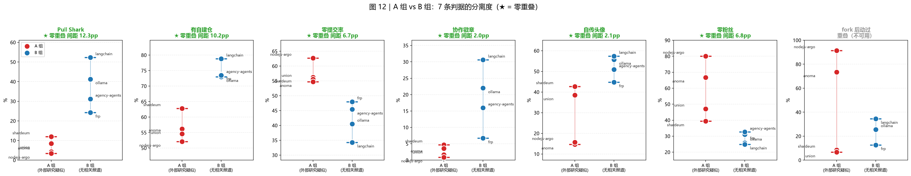

# GitHub Fork 异常检测：一个方法学案例

> **用公开数据判断「一个仓库的 fork 是不是被刷的」，能做到什么程度，以及必须在哪里停下。**

[](LICENSE)
[](requirements.txt)

---

## 一句话结论

> **7 条判据在「有外部质疑」与「无任何质疑」两组仓库之间点估计零重叠，
> 其中 4 条在 95% 置信水平下显著，最强的 `Pull Shark` 差 12.3 个百分点。**
>
> **但我们能证明的是「forker 的产出结构不同」，不是「有人付钱造假」。**

---

## ⚠️ 表述边界（必读）

> **本研究不指控任何仓库或账号。**
>
> **A 侧**中的 shardeum / union / anoma 之所以被列为对照，
> 是因为**第三方公开研究**（[arXiv:2412.13459](https://arxiv.org/abs/2412.13459)）
> 把它们列为**疑似**案例 —— 该研究原文用词即为 **"suspected"**。
> `eooce/nodejs-argo` 是我们自己的仓库元数据观测（fork/★ = 1.60）。
> **相关项目方可能否认，这完全正当。**
>
> 本项目只做**群体统计**，不对任何项目、任何账号下定性结论。
> 详见 [表述边界与免责](docs/research/表述边界与免责.md)。

---

## 这是什么 / 不是什么

| ✅ 这是 | ❌ 这不是 |
|---|---|
| 一个**方法学案例**：量化「公开数据能判断什么」的上限 | 一个造假检测工具 |
| 一次**判据证伪实验**：21 条直觉判据里大部分失效 | 一份指控清单 |
| **可复现**的采集与分析代码 + 文档 | 一套「可疑度打分」产品 |
| 只做群体统计，不点名 | 账号级定性 |

---

## 核心结果

### 7 条判据点估计零重叠，4 条统计显著

| 判据 | A 侧（4 仓） | B 侧（4 仓） | 间距 | 95% CI |
|---|---:|---:|---:|:---:|
| **`has_pull_shark`** | 3.4–12.0% | **24.3–52.3%** | **12.3pp** | ✅ 显著 |
| **`has_own`** | 52.1–62.8% | **73.0–78.8%** | **10.2pp** | ✅ 显著 |
| **`followers_zero`** | 39.4–80.1% | **24.9–32.6%** | **6.8pp** | ✅ 显著 |
| **`commit_zero`** | 54.7–62.7% | **34.3–48.0%** | **6.7pp** | ✅ 显著 |
| `following_zero` | 36.1–73.0% | 29.4–33.3% | 2.8pp | ❌ 提示性 |
| `avatar_photo` | 14.7–42.7% | 44.8–57.4% | 2.1pp | ❌ 提示性 |
| `has_collab` | 0.9–4.7% | 6.7–30.6% | 2.0pp | ❌ 提示性 |

**A 侧**：shardeum、union、anoma、`eooce/nodejs-argo`
**B 侧**：ollama、langchain、`fatedier/frp`、`msitarzewski/agency-agents`



---

## 最值得读的一个发现：判据会随对照扩而衰减

| 判据 | 2 仓对比 | 3A/2B | 4A/4B（初） | **4A/4B（全量）** |
|---|---:|---:|---:|---:|
| `Pull Shark` | — | 32.3pp | 11.1pp | **12.3pp** |
| `has_own` | — | 11.6pp | 6.7pp | **10.2pp** |

**每加一个干净对照，判据就弱一分。**

最典型的是 `frp`：它是真实、干净、高热度的工具型项目，
但它的 forker 里 `Pull Shark` 只有 **24.3%** —— 远低于 ollama（41.3%）和 langchain（52.3%）。
**没有这个对照，我们会以为「Pull Shark < 13% 就是异常」，实际上正常仓库也能低到 24%。**

> 反过来，**数据补齐又能"救活"判据**：agency-agents 样本从 2,000 扩到 6,370 后，
> `followers_zero` 的间距从 0.3pp（无意义）跳到 **6.8pp（显著）**。
>
> 完整记录见 [采集完整性报告](docs/data/采集完整性报告.md)。

---

## 数据规模

| 项 | 数值 |
|---|---:|
| 仓库 | **17** |
| forker 名单合计 | **361,241** |
| 已采唯一账号 | **298,265（82.6%）** |
| 缺口 | 62,976（抽样截断 41,236 + 采集中断 21,456） |
| 维度 | 9 个可采维度（D13 因隧道限制不可得） |

> **原始数据不在仓库里**（体积大 + 含个人可识别信息）。
> 采集脚本完整开源，任何人可自行复现；数据结构见 [数据结构设计](docs/data/数据结构设计.md)。

---

## 快速开始

```bash
git clone <this-repo>
cd <this-repo>
pip install -r requirements.txt

# 1) 采一个仓库的 fork 名单（无需 token）
python scripts/collect/collect_run.py --repo fatedier/frp --list-only

# 2) 一人一条采集（按维重试 + 多轮）
python scripts/collect/collect_full.py --repo fatedier/frp --workers 16

# 3) 看覆盖矩阵
python scripts/ops/_dim_matrix.py

# 4) 算判据对比
python scripts/analysis/_compare_full.py --tags agencyagents frp nodejsargo

# 5) 出结论图
python scripts/figures/_make_ab_figure.py
```

**通道说明**：默认走直连。若需高并发，在 `config/settings.json` 配置代理
（模板见 `config/settings.example.json`，真实配置已 gitignore）。
凭据文件永不入库。

---

## 文档地图

```
docs/
├── README.md                  ← 完整索引（按主题查找）
├── CONTRIBUTING.md            ← 研究规范（写报告前必读）
├── research/                  ← 研究结论（先读这里）
│   ├── 完整分析报告.md         ⭐ 一页读完全部工作
│   ├── 研究报告.md             ← 详细版（含 8 次自我否定记录）
│   ├── fork与账户质量分析.md
│   └── 表述边界与免责.md        ← 引用前必读
├── data/                      ← 数据
│   ├── 数据结构设计.md
│   ├── 采集完整性报告.md
│   ├── 采集结果示例.md
│   ├── 账户画像demo.md
│   └── 维度采集清单.md
├── method/                    ← 方法
│   ├── 采集方案.md
│   ├── 对照组设计.md
│   ├── 特征清单.md
│   ├── 指标设计清单.md
│   └── 图表与报告生成.md
├── selection/                 ← 如何选样
│   ├── 候选仓库筛选.md
│   └── 新一批候选仓建议.md
├── history/                   ← 历史版本（数字已过时，仅存档）
└── archive/                   ← 更早的设计文档
```

**推荐阅读顺序**：`research/完整分析报告` → `research/表述边界与免责` → `data/数据结构设计` → `method/对照组设计`

---

## 代码地图

```
scripts/
├── collect/       采集：fork 名单 + 9 个维度
│   ├── collect_core.py    统一采集核心（九态结果、墓碑、断点续采）
│   ├── fetchers.py        各维度抓取 + 解析
│   ├── collect_full.py    一人一条采集（按维重试 + 多轮补齐）
│   └── _full_run.py       全量驱动（三阶段：5维 → D9/D6 → D15）
├── analysis/      分析：特征工程、判据对比
│   └── _compare_full.py   逐维度合并 + 每指标用自己的分母
├── figures/       出图
└── ops/           运维：覆盖矩阵、配额探测、仓库筛选
```

**三个关键实现细节**（都是踩过坑才加的）：

| 细节 | 为什么 |
|---|---|
| 九态结果（`OK`/`EMPTY`/`DELETED`/…） | 用 `http=0` 表达"没采到"会混淆三种完全不同的情况 |
| 每指标用自己的分母 | 只统计"全维完整"的账号会**系统性丢掉仓多、提交多的账号** |
| 逐维度取最优 | 单维补采产生的记录维度少，按"维度最多"挑会被整个丢弃 |

---

## 开源范围

### ✅ 已开源

| 内容 | 说明 |
|---|---|
| 全部采集与分析代码 | 56 个脚本 |
| 全部文档 | 24 份 |
| 全部图表 | 17 张 |
| 配置模板 | `config/settings.example.json` |

### ❌ 不入库

| 内容 | 原因 |
|---|---|
| **原始采集数据**（约 1.3 GB） | 体积 + 含个人可识别信息 |
| **代理凭据** | 已在 `.gitignore`（`data/proxy_*.json`、`config/settings.json`） |
| **账号级原始记录** | 隐私；报告只给分桶统计 |
| **`AGENTS.md`** | 含本机环境信息 |

**数据可复现性**：采集脚本 + 维度定义 + 参数都开源，任何人可自行复现。
如需数据用于学术复核，请开 issue 说明用途。

---

## 合规与伦理

| 原则 | 做法 |
|---|---|
| **匿名只读** | 不使用任何 token、不登录、不使用任何人的 cookie |
| **不抓取私有信息** | `star/watch` 名单仅仓库所有者可读（匿名 401、带普通 token 404），本项目**承诺不取** |
| **邮箱只落布尔** | 只存 `has_email`，不存明文 |
| **不点名账号** | 只输出分桶计数与判据区分度 |
| **不推断动机** | 只描述形态差异，不推断"是否造假" |
| **遵守限流** | 单机单 IP 并发受控，不绕过 rate limit |

---

## 引用

```bibtex
@misc{github-fork-anomaly-2026,
  title  = {GitHub Fork 异常检测：一个方法学案例},
  year   = {2026},
  note   = {用公开 fork 侧数据量化「异常判断」的精度上限},
  url    = {<repo-url>}
}
```

若引用本文结论，**请同时引用其边界**：本研究只能证明群体层面的形态差异，不能证明任何具体仓库或账号的造假行为。

---

## 许可

代码：[MIT](LICENSE)
文档与图表：CC BY 4.0

---

## 致谢

- 对照组的定义参考了 [arXiv:2412.13459](https://arxiv.org/abs/2412.13459)（原文用词为 "suspected"）
- 采集遵循 GitHub 公开 API 的使用条款
