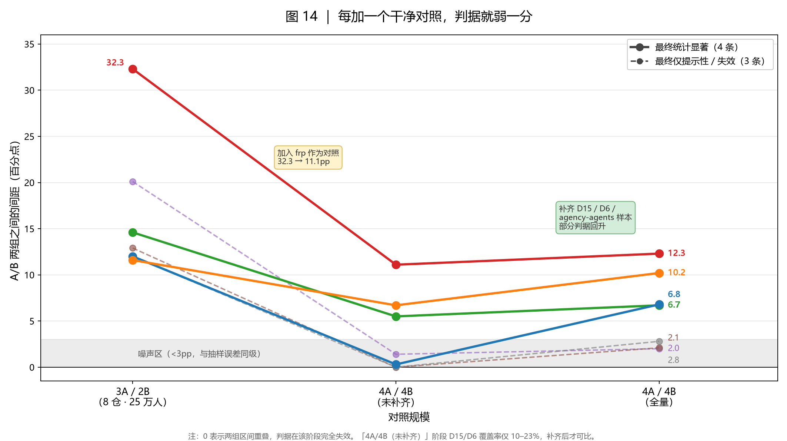

# fork-detectability

> **一个方法学研究：用 29.8 万个 forker 的公开数据，
> 回答「一个仓库的 fork 是不是被刷的」这件事，到底能不能测出来。**

[](LICENSE)
[](requirements.txt)
[](docs/README.md)

<div align="center">

### 📖 从哪开始读

| 你想 | 读这个 | 时长 |
|---|---|---|
| **看完整研究** | [**完整分析报告**](docs/research/完整分析报告.md) | 约 1 小时 |
| **看判据怎么被证伪** | [阶段记录（3A/2B 时期）](docs/history/研究报告_3A2B阶段.md) | 约 2 小时 |
| **只想看结论** | 往下滚 30 秒 | 30 秒 |
| **要引用/转载** | [**表述边界与免责**](docs/research/表述边界与免责.md) | **必读** |

</div>

---

## 一句话结论

> **7 条判据在「有外部质疑」与「无任何质疑」两组仓库之间零重叠，
> 4 条在 95% 置信水平下显著，最强的差 12.3 个百分点。**
>
> **但我们能证明的是「forker 的产出结构不同」，不是「有人付钱造假」。**

---

## 为什么是 fork，而不是 star

这个项目原本想做的是 **star 造假**——这件事已经有学术研究在做。

**但 star 名单拿不到。**

| 端点 | 匿名 | 非所有者 token | 仓库所有者 |
|---|:---:|:---:|:---:|
| `/repos/{o}/{r}/forks` | **200 ✅** | 200 | 200 |
| `/repos/{o}/{r}/stargazers` | **401** | 404 | 200 |
| `/repos/{o}/{r}/subscribers` | **401** | 404 | 200 |

<sub>2026-11-21 实测。401 = `Requires authentication`；非所有的 token 得到 404，GitHub 用"不存在"隐藏"无权限"。</sub>

于是退而求其次：**只能处理 fork 账户名单。**

这个退让决定了整个项目的形状——star 侧的指标一条都做不了，
fork 侧成了唯一还能看的观测面。研究问题因此从「这些星是不是买的」
降级为「这些 fork 背后是不是真人」。

有意思的是这个分野本身：**GitHub 把「代码副本」（fork）当公开信息，
把「个人行为」（star / watch）当隐私。** 我们能研究的，恰好只是前者。

---

## 一场从"以为很简单"开始的失败

2026 年 11 月，我们开始做这件事的时候，以为答案会很简单。

最像的信号就在眼前：**fork 之后，这个人有没有动过代码？**
真 fork 的人总会改点东西再推上去；刷出来的 fork 会永远躺在那里，一动不动。

于是我们拉了一个"有外部质疑"的仓（A 组）和一个"公认干净"的仓（B 组）来比。
结果是这样：

| 仓库 | fork 后动过 | 组 |
|---|---:|---|
| union | 6.6% | A |
| shardeum | 8.5% | A |
| ollama | 25.6% | B |
| langchain | 34.6% | B |
| **anoma** | **73.5%** | **A** |

**A 组从 6.6% 一直排到 73.5%，把 B 组整个包在了中间。**

它不是"异常信号"，它测的是**「fork 是拿来用，还是拿来收藏」**——
加密项目的用户把仓收藏起来等空投，工具项目的用户把仓拉下来跑一遍。
跟真假无关。

**第一个判据，当天就死了。**

---

## 于是我们开始加对照

一个判据死了，就换一个。每换一个，都要再找一个干净仓库当尺子。

然后我们发现一件比"找到判据"更要紧的事：

> **每加一个干净对照，判据就弱一分。**

最狠的一刀来自 `fatedier/frp`——一个真实、干净、十几万星的工具型项目。
它没有任何异常报道，但它的 forker 里，`Pull Shark`（协作徽章）只有 **24.3%**，
远低于 ollama 的 41.3% 和 langchain 的 52.3%。

| 判据 | 2 仓对比 | 3A / 2B | 4A / 4B |
|---|---:|---:|---:|
| `Pull Shark` | — | **32.3pp** | **12.3pp** |
| `has_own`（有自建仓） | — | 11.6pp | **10.2pp** |

**没有 `frp` 这个对照，我们会以为「Pull Shark 低于 13% 就是异常」。
实际上，一个完全正常的仓库也能低到 24%。**

判据的间距，就这样被一个诚实的对照砍掉了一半以上。



<sub>横轴是对照规模，纵轴是 A/B 两组之间的间距。**0 表示区间重叠——判据当场失效。**
七条判据里有三条最后掉进了这个 3pp 以下的噪声区。</sub>

> 而这个项目里还有更难看的一段：我们中途提出过一个"发现"——
> `watchers/★` 可以当低成本筛选信号——后来自己把它撤回了。
> 因为那 5 个"验证仓"是**我们按 `watchers/★` 挑的**。
> 先按预测变量选样，再观察它与结果同向，这是循环论证，不是验证。
> 详见[报告 §6.2](docs/research/完整分析报告.md)。

---

## 最后活下来的四条

把对照做足、把数据补齐之后，7 条判据在两组之间全部零重叠。
但真正经得起 95% 置信检验的，只有 4 条：

| 判据 | A 侧（4 仓） | B 侧（4 仓） | 间距 | 显著 |
|---|---:|---:|---:|:---:|
| **`Pull Shark`** 协作徽章 | 3.4–12.0% | **24.3–52.3%** | **12.3pp** | ✅ |
| **`has_own`** 有自建仓 | 52.1–62.8% | **73.0–78.8%** | **10.2pp** | ✅ |
| **`followers_zero`** 零粉丝 | 39.4–80.1% | **24.9–32.6%** | **6.8pp** | ✅ |
| **`commit_zero`** 零提交 | 54.7–62.7% | **34.3–48.0%** | **6.7pp** | ✅ |
| `following_zero` 零关注 | 36.1–73.0% | 29.4–33.3% | 2.8pp | ❌ 提示性 |
| `avatar_photo` 自传头像 | 14.7–42.7% | 44.8–57.4% | 2.1pp | ❌ 提示性 |
| `has_collab` 协作提交 | 0.9–4.7% | 6.7–30.6% | 2.0pp | ❌ 提示性 |

**A 侧**：shardeum、union、anoma、`eooce/nodejs-argo`
**B 侧**：ollama、langchain、`fatedier/frp`、`msitarzewski/agency-agents`


第一条最值得多看一眼。`Pull Shark` 要真的提过 PR、且被合并过才拿得到——
**它测的不是"有没有账号"，而是"有没有真的参与过协作开发"**。

A 侧 3.4–12.0% 的意思是：**那 88–97% 的 forker，从来没有在这台机器上协作过任何一次。**

而那正是最难造假的一条。

---

## 这件事到哪里为止

我们也想写"这就是刷量"。写不了。

| 我们能说 | 我们不能说 |
|---|---|
| 两组的 **forker 产出结构不同**，差异可复现 | 某个仓库**确实**买了星 |
| 差异在 95% 置信下显著 | 哪些账号是刷的 |
| 可以据此**缩小人工核查范围** | 是项目方买的，还是供应商自己刷的 |

**star / watch 的名单只有仓库所有者能读**（匿名 401，带普通 token 404），
本项目承诺匿名只读，所以那条路从一开始就封着。

> A 侧中的 shardeum / union / anoma 之所以被列为对照，
> 是因为**第三方公开研究**（[arXiv:2412.13459](https://arxiv.org/abs/2412.13459)）
> 把它们列为**疑似**案例——该研究原文用词即为 **"suspected"**。
> `eooce/nodejs-argo` 是我们自己的元数据观测。
> **相关项目方可能否认，这完全正当。**
> 本项目只做群体统计，不对任何项目、任何账号下定性结论。

完整的边界说明：[表述边界与免责](docs/research/表述边界与免责.md)（**引用本文结论前必读**）

---

## 数据是怎么来的

| 项 | 数值 |
|---|---:|
| 仓库 | **17** |
| forker 名单合计 | **361,241** |
| 已采唯一账号 | **298,265（82.6%）** |
| 每人维度 | 9 个可采维度 |
| 采集方式 | 匿名 · 只读 · 零 token · 不登录 |

**原始数据不在仓库里**（体积大、含个人可识别信息），但采集脚本、维度定义、
参数全部开源——任何人都能自己跑一遍，得到同样的数。
数据结构见[数据结构设计](docs/data/数据结构设计.md)，缺口归因见[采集完整性报告](docs/data/采集完整性报告.md)。

---

## 自己跑一遍

```bash
pip install -r requirements.txt

# 1) 采一个仓库的 fork 名单（无需 token）
python scripts/collect/collect_run.py --repo fatedier/frp --list-only

# 2) 一人一条采集（按维重试 + 多轮补齐）
python scripts/collect/collect_full.py --repo fatedier/frp --workers 16

# 3) 看覆盖矩阵
python scripts/ops/_dim_matrix.py

# 4) 算判据对比（每指标用自己的分母）
python scripts/analysis/_compare_full.py --tags agencyagents frp nodejsargo

# 5) 出结论图
python scripts/figures/_make_ab_figure.py
```

默认直连；需要高并发时在 `config/settings.json` 配代理
（模板 `config/settings.example.json`，真实配置已 gitignore，凭据永不入库）。

---

## 文档与代码

```
docs/
├── research/   完整分析报告 ⭐ · 研究报告 · fork与账户质量分析 · 表述边界
├── data/       数据结构 · 采集完整性 · 采集结果示例 · 账户画像 · 维度清单
├── method/     采集方案 · 对照组设计 · 特征清单 · 指标设计 · 图表生成
├── selection/  候选仓库筛选 · 新一批候选仓建议
├── history/    中间版本（数字已过时，仅存档）
└── archive/    更早的设计文档
```

```
scripts/
├── collect/    collect_core（九态）· fetchers · collect_full（一人一条）· _full_run
├── analysis/   _compare_full（逐维度合并 + 每指标自己的分母）
├── figures/    结论图 · 验证图
└── ops/        覆盖矩阵 · 配额探测 · 仓库筛选
```

**三个踩过坑才加上的实现细节**（都在[数据结构设计](docs/data/数据结构设计.md)里有解释）：

| 细节 | 不加会怎样 |
|---|---|
| 九态结果（`OK`/`EMPTY`/`DELETED`/…） | 用 `http=0` 表达"没采到"，会混淆三种完全不同的情况 |
| 每指标用自己的分母 | 只统计"全维完整"的账号，会**系统性丢掉仓多、提交多的账号** |
| 逐维度取最优 | 单维补采的记录维度少，按"维度最多"挑会被整个丢弃 |

---

## 这个仓库适合谁

| ✅ 适合 | ❌ 不适合 |
|---|---|
| 想了解「公开数据能判断什么、不能判断什么」 | 想找一个工具去查某个仓库 |
| 对判据设计、对照设计、证伪过程感兴趣 | 想要"可疑度打分" |
| 要给自己的研究找一份负面结果参考 | 想给某个项目定性 |

**本项目不接受"帮我查某个仓库"的请求，也不对具体仓库发表判断。**

---

## 许可与引用

代码 [MIT](LICENSE)；文档与图表 CC BY 4.0。

```bibtex
@misc{github-fork-anomaly-2026,
  title  = {fork-detectability: 用公开 fork 侧数据判断仓库异常的可行边界},
  author = {jimmy-Smile-ltl},
  year   = {2026},
  url    = {https://github.com/jimmy-Smile-ltl/fork-detectability}
}
```

> 引用本文结论时，**请同时引用它的边界**：
> 本研究只能证明群体层面的形态差异，不能证明任何具体仓库或账号的造假行为。

---

<div align="center">
<sub>

**一句题外话：**
这个项目最有价值的部分，可能不是那 4 条判据，
而是它记录了一个判据怎么从 32 个百分点一路缩到 12 个，
以及我们怎么在第八次自我否定时，把自己提的方法也划掉了。

</sub>
</div>
