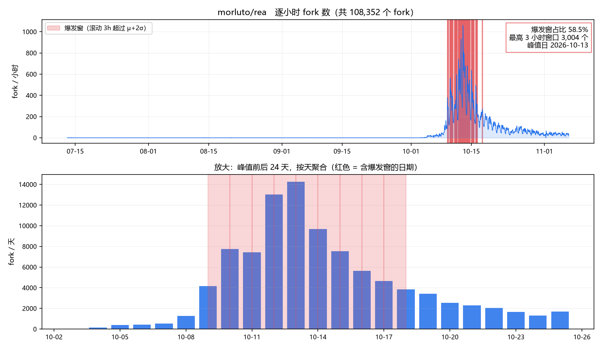
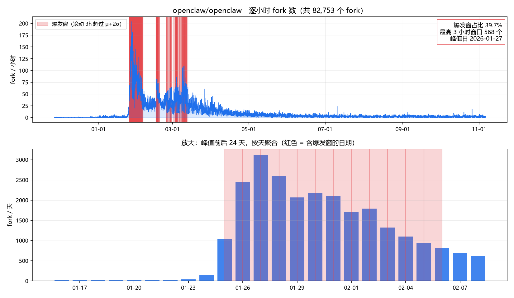
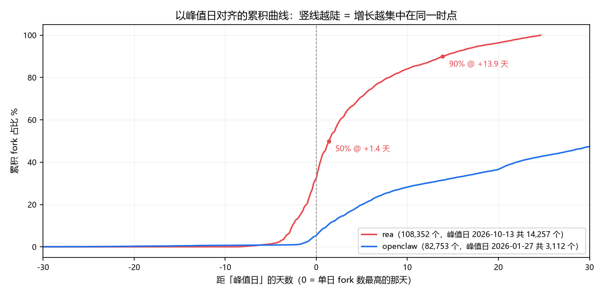

# GitHub 仓库刷量研究 · 项目总纲

> **版本**：2026-11-12 22:30（合并自 9 份分立文档；那 9 份已移入 [`归档_docs/`](归档_docs/README_归档说明.md)）
> **状态**：五套核心数据已完成（D1 96.2% / D13 两份全量 / D8 99%+ / D14 与 D1 对齐）；
> D15（主页画像含成就）采集中；D2–D6、D4L 排队等 API 配额
> **纪律**：匿名只读、不登录、不存邮箱明文、不给单个账号公开定性
> 本文档是**唯一权威版本**。归档里的数字大多是错的（单页抽样/错误分母），
> 正确值见 §七「更正记录」。

---

## 目录

1. [项目概览](#一项目概览)
2. [地基：fork 名单是唯一完整的身份通道](#二地基fork-名单是唯一完整的身份通道)
3. [数据采集](#三数据采集)
4. [数据结构](#四数据结构)
5. [指标与判据](#五指标与判据)
6. [登录名类型学](#六登录名类型学)
7. [已验证 / 已证伪（含更正记录）](#七已验证--已证伪含更正记录)
8. [两仓对照](#八两仓对照rea-vs-openclaw)
9. [当前进度与后续计划](#九当前进度与后续计划)
10. [纪律与边界](#十纪律与边界)
11. [附录](#附录-a-脚本清单)

---

## 一、项目概览

### 1.1 要回答的问题

一个 GitHub 仓库的 fork 数（以及 star 数）**是不是被刷出来的**？
如果是，**怎么用公开数据证明**？

### 1.2 核心方法

```
第一步：采集全部 fork 某个仓库的人的名单（唯一完整的身份通道）
第二步：采集这些账户的详细档案（D1 → D14）
第三步：对账户做多轴评价与分类
第四步：把「账户画像」与「fork 时间轴」交叉，找批量执行痕迹
```

用户原话（项目基石）：
> 当前项目核心思想是采集全部 fork 某个仓库的人的名单，采集这些账户的详细信息，对账户进行评价 分类。

### 1.3 目前的结论（2026-11-12 更新）

| 结论 | 强度 | 依据 |
|---|---|---|
| rea 的 fork 增长**形态高度异常** | 强 | 58.5% 的 fork 挤在极少几个 3 小时窗口；**峰值日 2026-10-13 单日 14,257 个**；最高 3 小时窗 **3,004 个** |
| rea 的 fork **绝大多数从未被使用** | 强 | 91.6% 的 fork 后从未 push（openclaw 66.5%） |
| 账号**本身是真实的**（不是批量注册假号） | 强 | 画像与普通 forker 无差异（≤2.2pp）；user_id 不相邻 |
| **同秒碰撞不是协调证据** | 强（更正） | 按小时局部速率校正后仅 1.02×（原报 8.14× 是错的） |
| fork 者里存在**大量低频账号** | 中 | 全年活跃 ≤5 天占 38.1%（全量 106,077 人；openclaw 33.7%） |
| 这些账号**是否为付费刷量** | **无证据** | 六项检验全阴性 |

> ⚠️ **必须守住的表述边界**：我们可以说"增长形态非自然"，
> **不能说"这是付费刷量"**——后者需要账号控制权、支付记录等外部证据。

#### 1.3.1 图：fork 增长时间轴（2026-11-12 生成）

**rea：全景 + 峰值期放大**



读图要点：
- 上半年几乎**零增长**（7 月到 9 月每月只有个位数）
- **10 月 8 日起突然启动**，10-13 达到单小时 1,000+ 的峰值
- 峰值日 **2026-10-13 单日 14,257 个**；最高 3 小时窗口 **3,004 个**
- 峰值后呈**长尾衰减**（10-20 之后仍有每天 1,000–2,000），说明推广是持续的，不是一次性

**openclaw（对照仓）：形态完全不同**



读图要点：
- 峰值日 2026-01-27 单日 **3,112 个**（只有 rea 的 22%）
- 最高 3 小时窗 **568 个**（只有 rea 的 19%）
- 增长**覆盖全年**（1 月到 11 月都有持续流量），不是"突然爆发 + 长尾"

#### 1.3.2 图：以峰值日对齐的累积曲线



**这张图最能说明问题**：把两个仓库的"单日峰值"对齐到 0 点，看累积占比怎么涨。

| 仓库 | 50% 的 fork 出现在 | 90% 出现在 |
|---|---|---|
| **rea** | 峰值日 **+1.4 天** | +13.9 天 |
| **openclaw** | 峰值日 +10 天之后（30 天窗口内还没到 90%） | 超出 30 天窗口 |

**rea 的曲线是一道近似垂直的墙**：一半的 fork 集中在峰值日前后 1.4 天内。
openclaw 的曲线平缓铺开，是正常的"慢慢被人发现"的形态。

> **判据说明**：这里的"爆发窗"定义是「滚动 3 小时计数 > μ+2σ」，
> μ/σ 由该仓自己的逐小时序列算出，**不用外部基准**。两个仓用同一套参数，
> 唯一差别是数据本身。

---

## 二、地基：fork 名单是唯一完整的身份通道

### 2.1 为什么不能采 star 名单

| 通道 | 匿名访问 | 说明 |
|---|---|---|
| `GET /repos/{o}/{r}/stargazers` | ❌ **401** | 需登录（任何 token），**不要求所有者** |
| `GET /repos/{o}/{r}/forks` | ✅ **200** | 完整、可分页、可排序、无 100 页上限 |
| `GET /repos/{o}/{r}/subscribers` | ❌ **401** | 需登录（任何 token） |
| `GET /users/{login}/subscriptions` | ❌ **204**（空） | 功能上已死，必须记 `unavailable` 而非 `{}` |

**结论：fork 名单是唯一**可匿名**获取的完整身份列表（star/watch 需登录）。**

### 2.2 三种身份名单的权限矩阵（2026-11-14 实测）

> ⚠️ **本节推翻了 2026-11-10 的旧结论。**
> 旧结论说"star/watch 名单仅仓库所有者可读（404）"——**错了**。
> 真实机制是"**需要认证**"：任何账号的 token 都行，不要求是仓库所有者。

#### 2.2.1 一张表看清三种名单的权限

| 名单 | 端点 | 匿名（无 token） | **有 token（非所有者）** | 仓库所有者 |
|---|---|---|:---:|---|
| **fork 名单** | `/repos/{o}/{r}/forks` | ✅ **200** | ✅ 200 | ✅ |
| **star 名单** | `/repos/{o}/{r}/stargazers` | ❌ **401** | ✅ **200** | ✅ |
| **watch 名单** | `/repos/{o}/{r}/subscribers` | ❌ **401** | ⚠️ 未实测（预期 200） | ✅ |
| 用户订阅列表 | `/users/{l}/subscriptions` | ❌ 204（空） | ⚠️ 未实测 | 本人 |

**证据强度**：
- 匿名列：**2026-11-14 逐条实测**（隧道代理每次换 IP，排除限流干扰）
- 有 token 列：star 名单由**官方文档**（`list stargazers` 标注需认证）+
  [`aegiswizard/fortune`](https://github.com/aegiswizard/fortune) 的实现佐证（它传 `GITHUB_TOKEN` 后能拉）
- watch 名单：仅测了匿名 401，带 token 未实测 → **标注为预期**

#### 2.2.2 匿名返回 401 的原文（可复现）

```http
GET https://api.github.com/repos/{owner}/{repo}/stargazers?per_page=1
Accept: application/vnd.github.star+json

HTTP/1.1 401 Unauthorized
X-RateLimit-Remaining: 59          ← 关键：不是限流
{"message":"Requires authentication",
 "documentation_url":"https://docs.github.com/rest/activity/starring#list-stargazers",
 "status":"401"}
```

**`X-RateLimit-Remaining: 59` 证明这不是配额问题**——
如果只是限流，会返回 403 且 body 里写 `rate limit exceeded`。

#### 2.2.3 三种名单分别能拿到什么字段

| 名单 | 每条记录的字段 | 时间戳 | 信息量 |
|---|---|---|:---:|
| **fork** | `login` `fork_id` `created_at` `pushed_at` `size_kb` `default_branch` `fork_language` `fork_stars` `owner_type` | ✅ **fork 时间 + 最后 push 时间** | **最丰富**（本项目 8 个判据靠它） |
| **star** | `login`（默认）<br>加 `Accept: application/vnd.github.star+json` 后含 `starred_at` | ✅ 点星时间 | 中（能算 star→fork 延迟） |
| **watch** | `login` | ❌ | 最少 |

**这就是本项目选 fork 通道的第一个理由**：字段最多、且唯一可匿名获取。

#### 2.2.4 配额差异（决定可行性）

| 身份 | 配额 | 拉 43 万 star 名单需要 |
|---|---:|---|
| 匿名 | **60 次/小时/IP** | 4,345 页 ÷ 60 ≈ **72 小时**（且只能拿到 fork，star 直接 401） |
| 有 token | **5,000 次/小时/token** | 4,345 页 ÷ 5,000 ≈ **1 小时** |
| 仓库所有者 | 同 token | 同上 |

#### 2.2.5 为什么本项目仍然不取 star 名单

**不是没权限，是我们自己承诺不用 token。**

| 纪律 | 内容 |
|---|---|
| 匿名只读 | 不使用任何 token、不登录、不使用任何人的会话 cookie |

所以对本项目：

| 表述 | 正确性 |
|---|---|
| "fork 名单是唯一**可匿名**获取的完整身份列表" | ✅ 正确 |
| "star / watch 名单**需要登录**才能取" | ✅ 正确 |
| "star 名单**只对仓库所有者**开放" | ❌ **错**（旧结论，已更正） |
| "带 token 也拿不到" | ❌ **错** |

#### 2.2.6 若放宽纪律会发生什么（供决策）

| 方案 | 能拿到的数据 | 代价 |
|---|---|---|
| **保持匿名（现状）** | fork 名单 108,352 + 82,753 | 无 |
| **加一个只读 token** | + star 名单 **434,469 条**（含 `starred_at`） | 违反"匿名只读"；需真实账号；约 1–2 小时 |

**star 侧是 fork 侧的 4 倍**，且 `starred_at` 能做时序——
意味着「star 与 fork 时间差」这个第 2 强判据（19.1pp）可以在 43 万人上验证，而非 10 万人。

**本项目选择不做**，并在报告里声明"结论仅覆盖 fork 侧"。

### 2.3 fork 名单为什么是唯一可行的完整身份通道

| 通道 | 可见范围 | 匿名可得？ |
|---|---|---|
| fork 列表 `/repos/{o}/{r}/forks` | **公开** | ✅ 200，完整可分页 |
| star 列表 `/repos/{o}/{r}/stargazers` | **仅仓库所有者** | ❌ 403 / 404 |
| watch 列表 `/repos/{o}/{r}/subscribers` | **仅仓库所有者** | ❌ 401 / 404 |
| 用户 watch 列表 `/users/{l}/subscriptions` | **仅本人** | ❌ 204 / 404 |

**结论**：在公开可见性上，fork 列表是 2026 年唯一还能拿到的完整身份列表；
这不是"技术漏洞"，而是 GitHub 把 fork 设计成公开行为、把 star/watch 设计成（对所有者之外的）隐私数据。

### 2.4 fork 名单的实测特性（2026-11-06）

| 特性 | 值 |
|---|---|
| 端点 | `GET /repos/{owner}/{repo}/forks?per_page=100&page=N` |
| 每页上限 | **100**（不能更多） |
| 页数上限 | **无**（rea 实测翻到第 1,085 页） |
| 排序 | `sort=oldest`（全量回填，游标稳定）/ `sort=newest`（增量，撞到已知就停） |
| `since` / `until` 参数 | ❌ **不存在** |
| rea 总量 | 108,352 条 / 1,085 页 |
| openclaw 总量 | 82,753 条 / 828 页 |

### 2.5 fork 记录里自带的两列（0 请求的宝贝）

| 字段 | 含义 | 为什么重要 |
|---|---|---|
| `fork.created_at` | 这个 fork 被创建的时间 | 时间轴分析的全部基础 |
| `fork.pushed_at` | 这个 fork 最后一次被 push 的时间 | **`pushed_at > created_at` = 这个人动过手** |

`fork 后动过率` 是**目前最强的单一行为判据**，且完全零请求。

---

## 三、数据采集

### 3.1 配额与限流（详解）

> 这一节回答三个问题：**配额的粒度是什么、超了会返回什么、代码怎么处理**。
> 所有数字都是 2026-11-09/10 在真实采集里实测的，不是抄文档。

#### 3.1.1 配额按「资源桶」分，不按端点分

GitHub 匿名身份下调用 `GET /rate_limit` 的真实返回：

| 桶 | 限额 | 覆盖的端点 |
|---|---:|---|
| **`core`** | **60 / 小时** | `/users/*` `/repos/*` `/orgs/*` `/events` `/forks` `/commits` `/starred` `/subscriptions`……**几乎所有端点** |
| **`search`** | **10 / 分钟** | `/search/repositories` `/search/users` `/search/issues` `/search/commits` |
| **`code_search`** | **10 / 分钟**（匿名 60/h） | `/search/code` |
| **`graphql`** | **0**（必须登录） | `/graphql` |
| `integration_manifest` | 5,000 | GitHub App 清单，与我们无关 |

**关键推论：换端点不会变快。** D1 和 D8 抢的是同一个 `core` 桶。
多种采集并行只会在同一个桶里互相挤，不会增加总吞吐。

| 我们的单元 | 走哪个桶 |
|---|---|
| D1 D2 D3 D4 D4L D6 D8 D9 D11 | `core`（共享 60/h） |
| D12 | `search`（独立 10/min） |
| **D13 贡献日历** | **不走 API，0 配额** |
| **D14 头像** | **CDN，0 配额** |

#### 3.1.2 两层 60，叠在一起才是真相

| 限制方 | 规则 | 谁统计 | 超了的表现 |
|---|---|---|---|
| **GitHub** | 每个 IP 每小时 60 次 core 请求 | GitHub | 返回 **403**，`X-RateLimit-Remaining: 0` |
| **快代理 KDL** | 每个出口 IP 每小时可用 60 次；每次提取只给 5 个、约 6 分钟轮换 | KDL | IP 直接失效（连接失败） |

两个 60 **独立计算**，必须同时满足：

```
有效吞吐 = 可用 IP 数 × 60 / 小时
        = 55 × 60 = 3,300 / 小时 ≈ 55 请求/分钟   ← 固定值，加线程无效
```

#### 3.1.3 超出配额的**真实返回**（抓包原文）

对一个 `remaining = 0` 的出口发真实请求，拿到：

```http
HTTP/1.1 403 Forbidden
x-ratelimit-limit: 60
x-ratelimit-remaining: 0
x-ratelimit-reset: 1794245478
x-github-media-type: github.v3; format=json

{"message":"API rate limit exceeded for 123.174.56.227. (But here's the good news:
 Authenticated requests get a higher rate limit. Check out the documentation for more details.)",
 "documentation_url":"https://docs.github.com/rest/overview/resources-in-the-rest-api#rate-limiting"}
```

三个细节值得记住：

1. **必须看 body 才能确认是配额**：403 也可能是权限问题，但 body 里出现
   `API rate limit exceeded` 就是配额。
2. **body 里会暴露真实出口 IP**：`123.174.56.227` 与我们连接的代理 IP（`110.x.x.x`）
   **不是同一个**——KDL 隧道有自己的出口。所以"换代理 IP"不等于"换 GitHub 眼中的 IP"。
3. **`x-ratelimit-reset` 是恢复时刻**，代码用它决定这个 IP 何时可以再用。

#### 3.1.4 代码怎么处理（`_profile_lib.quota_get`）

```
for 最多 max_attempts 次:
    node = pool.current()                    # 取一个出口
    r = GET(url, proxies=node)
    if r.status in (200, 404):               # 定论
        if remaining <= SAFE_REMAIN: rotate()   # 提前换下一个
        return r
    if r.status in (403, 429):
        if remaining == 0 and reset:
            pool.record_dead(node, until_ts=reset)   # 该 IP 本小时报废
        else:
            pool.record_dead(node)                   # Retry-After / 风控
        rotate()                                      # 立刻换 IP
        sleep(Retry-After)                            # 尊重服务端退避
        continue                                      # 重试同一个 URL
    sleep(3)                                          # 5xx：短退避
return (0, None)                                      # 重试耗尽 → 失败墓碑
```

**要点**：
- 403 **不直接判失败**，而是"换 IP 重试"
- 每个 IP 的死亡时间被记录，避免反复试同一个死 IP
- 只有连换 5–12 个 IP 都拿不到 200/404，才落一条 `http=0`

#### 3.1.5 失败的真实规模（openclaw D1 实测，52,587 条记录）

| http | 条数 | 占比 | 含义 |
|---|---:|---:|---|
| **200** | 40,934 | **77.8%** | 成功 |
| **0** | **11,167** | **21.2%** | **配额/代理摩擦，重试耗尽** |
| 404 | 486 | 0.9% | 账号已删/改名 |

**关键证据**：这 11,167 条失败**全部没有 `error` 字段**——
说明它们不是程序异常（异常会写 `type(e).__name__`），
而是 `quota_get` 返回 `(0, None)`，即**重试耗尽**。

对比 404 只有 0.9%，说明"账号采不到"这件事几乎不存在，**失败几乎全是配额问题**。

#### 3.1.6 失败能否救回（已验证）

| 证据 | 数值 |
|---|---|
| rea 首轮失败墓碑 | 5,308 个 |
| 补采轮救回 | **3,521 个（66%）** |
| rea 覆盖率变化 | 94.8% → **98.7%** |

原因很简单：403 是**临时的**（每小时重置），换个时间重试就能成功。
所以**失败率不是数据丢失，而是配额摩擦的成本**。

#### 3.1.7 三个容易误解的点

| 误解 | 实际 |
|---|---|
| "304 也算一次配额" | ❌ **条件请求 304 不计费**，缓存命中是真正免费 |
| "登录能解决" | 能（5,000/h），但**本项目纪律是匿名只读**，所以永远按 60 算 |
| "额度没超就能随便打" | ❌ 还有**二级限流**：并发过高/短时爆发会被 403 拦，响应带 `Retry-After` |

#### 3.1.8 各通道的实测上限

| 通道 | 速率上限 | 说明 |
|---|---|---|
| `api.github.com`（匿名直连） | **60 请求/小时/IP** | 且国内直连被墙 |
| `api.github.com`（快代理 KDL） | **≈55 请求/分钟（3,300/小时）** | 硬顶 = 可用 IP 数 × 60 |
| `github.com`（HTML 页面，直连） | 0 API 配额，但**跑 5,000 次后整机断连** | 实测被网络层掐断 |
| `github.com` 经 Clash（7897） | **≈192 人/分钟/实例**（两实例并行 ~600） | 不消耗快代理配额，走 VPN 带宽 |
| Clash 走 `api.github.com` | 60/小时（独立配额） | 有额度但极小；**Clash 未开 external-controller，无法轮换节点** |

**并发实验结论（2026-11-07 实测）**：

| 线程 | 吞吐 | 失败率 | 净成功率 |
|---:|---:|---:|---:|
| 6 | 48 人/分钟 | 23% | 37 人/分钟 |
| 10 | 60 人/分钟 | 35% | 37 人/分钟 |
| 16 | 29 人/分钟 | 15% | 25 人/分钟 |

→ **加线程没有用**（净成功率一样），瓶颈是快代理的出口 IP 数量。6 线程最优。

### 3.2 采集单元 D1–D15

| 单元 | 端点 | 请求 | 落盘内容 | 属于哪根轴 |
|---|---|---:|---|---|
| **D1** | `/users/{login}` | 1 | 15 字段 + `has_email` 布尔 | 身份自证 |
| **D2** | `/users/{login}/events/public` | 1–3 | 近 **90 天**事件类型分布 | 行为 |
| **D3** | `/users/{login}/repos?per_page=1&sort=pushed` | 1 | 仓总数 + 最近 push | 行为 |
| **D4** | `/users/{login}/starred?per_page=1` | 1 | star 总数 | 身份自证 |
| **D4L** | 同 D4 + `Accept: star+json` | 1/页 | star 明细 + 时间戳 | 行为 |
| **D5** | `subscriptions?per_page=1` | 1 | watch 总数（未验证） | — |
| **D6** | `/orgs?per_page=100` | 1 | 组织列表 | 身份自证（弱） |
| **D7** | `github.com/{login}` HTML | 0 API | 贡献日历/成就/README | 已被 D13 取代 |
| **D8** | `/repos?per_page=100&sort=pushed&page=N` | 1–10 | **自建 vs fork 结构** ★ | 身份自证（最强） |
| **D9** | `/repos/{o}/{r}/commits?author=` | 1/仓 | 本人在该仓提交数 | 行为（**已搁置**） |
| **D10** | `followers|following` 计数 | 2 | D1 已含 | — |
| **D11** | `/repos/{o}/{r}` | 1 | 单仓详情（parent/source） | 辅助 |
| **D12** | `/search/commits?q=author:` | 1 | 全站提交总数 | 行为（10/min） |
| **D13** | `github.com/users/{login}/contributions?from=…&to=…` | 0 API | **整年 365 天逐日贡献** ★ | 行为（最强） |
| **D14** | `avatars.githubusercontent.com/u/{id}?v=4` HEAD | 0 API | 头像大小 → identicon vs 照片 | 身份自证（弱） |
| **D15** | `github.com/{login}` HTML | **0 API** | **star 数 + 仓数 + 成就徽章 + 名字 + pinned** ★ | 身份自证（新） |
| **D8H** | `github.com/{login}?tab=repositories` HTML | 0 API | 同 D8（二分类准确率 96%） | 身份自证 |

#### 3.2.1 HTML 通道：一个页面榨出四个维度（2026-11-12 新增）

用户提出的思路：**能数网页就别调 API**。实测确认个人主页 `github.com/{login}`
**一个响应里同时带着**：

| 字段 | HTML 位置 | 实测校验 |
|---|---|---|
| **仓库数** | `<span title="12" class="Counter">` 第 1 个 | `torvalds` = 12，与 API `public_repos` 一致 |
| **star 数** | 同款 `Counter` 第 4 个 | `torvalds` = 2，与个人页 "Stars 2" 一致 |
| **成就徽章** | `alt="Achievement: Pull Shark"` | 一次拿到 5 个（含 Pull Shark / Starstruck） |
| 显示名 | `itemprop="name"` | 可用 |
| pinned 仓库 | `pinned-item-list-item-content` | 可用 |

**为什么 HTML 不消耗 API 配额**：

| 入口 | 限流方式 | 特征 |
|---|---|---|
| `api.github.com` | **硬配额** 60/h/IP，计数器明确 | 超了立刻 403，按小时重置 |
| `github.com` 网页 | **软风控**：按速率/并发/行为判定 | 无小时计数；400/分钟没事，连续 5,000 次会被掐 |

#### 3.2.2 成就徽章：不用 API 就能拿到"真实开发者"证据

| 徽章 | 授予条件 | 判据价值 |
|---|---|---|
| **Pull Shark** | **合并过 Pull Request** | ★★★ 直接证明写过代码 |
| **Pair Extraordinaire** | 与他人协作提交过 | ★★ 证明参与协作 |
| **Starstruck** | 自有仓库被 star | ★★ 证明作品被认可 |
| Quickdraw | 快速关闭 issue/PR | ★ |
| Arctic Code Vault | 2020 年有公开仓 | ★ 证明账号老 |

**为什么比"有没有自建仓"强**：有仓不等于写过代码（可以是空仓或 fork 后改名），
但**合并过 PR 一定是真开发行为**。而且它藏在个人主页里，**0 额外请求**。

#### 3.2.3 实测：`?tab=stars` 是浪费请求

单独请求 `?tab=stars` 只为数 star，而个人主页里已有这个数字。
**同样请求数，个人主页多给三个维度。** `_profile_starcount_html.py` 已废弃，
统一用 `scripts/collect/_profile_html_all.py`。

#### D1 落盘字段（15 + 1）

`user_id` `type` `name` `company` `blog` `location` `hireable` `bio`
`twitter_username` `public_repos` `public_gists` `followers` `following`
`created_at` `updated_at` `has_email`(布尔)

派生：`account_age_days` / `age_at_fork_days` / `profile_filled`(0–6) /
`profile_shape`(EMPTY|TEMPLATE|PARTIAL|RICH)

#### D2 落盘字段（7）

`events_total` `by_type` `dev_events` `watch_events` `distinct_repos` `first_at` `last_at`

> ⚠️ **API 硬限制：只保留最近 90 天、最多 300 条。**
> 实测 106 人样本：跨度中位 **18 天**、事件数中位 **10 条**。
> **要"全年活动"只能用 D13，D2 给不了。**

#### D8 落盘字段（13）

`sampled_repos` `fork_count` **`own_count`** `own_empty` **`own_touched`** `own_newest_push`
`fork_newest_push` `own_details` `fork_details` **`has_profile_repo`** `repos_complete`
`pages_used` `repos_total_hint`

> **铁律**：`own_count == 0` **只有在 `repos_complete == 1` 时才成立**。
> 仓超过 1000 个的账号翻不完，`own_count` 只是采样值。

#### D9 为什么搁置（2026-11-09 决定）

- **成本** = Σ(每个人的自建仓数)。101 人样本：自建仓中位 **4**、均值 **9.9**、最大 71
- 只抽查 3 个仓 → 人均 2.0 请求 → 19 万人 **37.8 万请求 ≈ 115 小时**
- 全部查 → 人均 9.9 → **189 万请求 ≈ 24 天**
- **只有自建仓有意义**：fork 仓里的提交是上游作者写的，查本人的 `author` 只会得到 0
- **替代品（0 请求）**：D8 的 `own_touched` / `own_newest_push`
- **代码状态**：`c_d9(pool, login, own_repos)` 已写好，**传入空列表直接跳过不发请求**，
  且**不在任何 TIERS 里**——即"逻辑已处理，暂不调用"

#### D13 为什么是最强信号

| 指标 | 定义 | 实测案例 |
|---|---|---|
| `ACTIVE_DAYS` | 年内有贡献的天数 | 真人几十~几百；僵尸号 0–1 |
| `SINGLE_ACTION_YEAR` | 全年只有 1 天有贡献 | `1733268368`：**1 天 1 次，就在 fork 当天** |
| `ACTION_ALIGNED` | 那唯一一天是否落在爆发窗 | `saulnhodges`：1 天 1 次，在注册当天 |

> 解析：`data-date` + `data-level` + `<tool-tip>` 里的 `N contributions`；
> 一次只能请求**一整年**（不支持单月）。

### 3.3 采集档位

| 档位 | 单元 | 请求/人 | 用途 |
|---|---|---:|---|
| `screen` | d1 | **1** | 十几万人第一遍粗筛 |
| `rehearsal` | d1 d4 d8 | 3 | 50 人判据验证 |
| `minimal` | d1 d2 d3 d4 | 4 | 有行为的粗筛 |
| `standard` | +d6 | 5–6 | 加组织 |
| `full` | +d8 | 6–9 | 完整画像 |
| `deep` | d1 d2 d3 d4 d4l d6 d8 | 8 | 50 人样本 |
| **`behavior`**（新） | d1 d2 d8 | 2–3 | 只回答"是否还活着/有没有作品" |

### 3.4 状态集合（断点续采）

```
CollectState(name, tier, units)
  ├─ Redis（优先，快）  grf:v1:{name}:{tier}:{done|gone|partial}
  └─ SQLite（备用）    data/state/collect_state.db
```

**三条铁律**：

1. **JSONL 是唯一事实来源**；Redis/SQLite 只是索引，丢了可重建
2. **每次启动先 `warm_from_jsonl()`**——不 warm 就读到陈旧快照（曾因此差 1.2 万账号）
3. **Redis 挂掉必须自动降级 SQLite**（已实现 `_call` 容错 + `check_same_thread=False` 写锁）

实测事故：
- Redis 崩溃 → 6 个线程全死 → 首轮提前结束，29,354 个账号**从未被尝试**
- 出口池取不到 IP → 线程阻塞 11 分钟 → 静默卡死 3.6 小时（已加看门狗，20 分钟无写入即退出）

### 3.4.1 长跑采集的五条运维经验（2026-11-10/12 实战）

这两天在 19 万人规模上连续跑了 60+ 小时，踩出来的五条，全部已固化进代码：

| # | 教训 | 现象 | 对策（已实现） |
|---|---|---|---|
| 1 | **进程跑久必退化** | D13 从 400/分钟掉到 3/分钟；D1 从 300 掉到 20 | **定时重启**（`_supervise*.ps1`，5–10 分钟一轮），进度在文件里，重启无损 |
| 2 | **配额打空后整轮 403** | D4 前 50 个全失败 | **配额感知**：每轮先探 `X-RateLimit-Remaining`，为 0 就等 6 分钟（`scripts/ops/_quota_check.py`） |
| 3 | **等待轮次不能算重试上限** | 40 轮里 30 轮在等待 → 触发上限 → **静默跳过未完成阶段** | 用独立计数器 `$ran`，只统计真正启动的次数 |
| 4 | **`pending = -1` 不等于失败** | 新阶段文件尚未生成 → 被误判"读不到"直接跳过 | 视作"全量待采"，正常启动 |
| 5 | **"未尝试"与"待重试"必须分开排队** | 重试的账号总在队头 → 尾部 13,070 人**永远轮不到** | 先跑"从未尝试名单"（`*_never.txt`），跑完再补墓碑 |

> 第 5 条最隐蔽：文件已经有 12 万行，看着一直在干活，
> 但**尾部 1.3 万人一次都没被请求过**。诊断方法：拿名单减文件里的唯一 login 集合。

### 3.5 采集台账（2026-11-12 22:00）

| 仓库 | 账户目标 | D1 成功 | 删号 | D1 待重试 | 覆盖率 |
|---|---:|---:|---:|---:|---:|
| `morluto/rea` | 108,340 | **106,951** | 324 | 1,065 | **98.7%** ✅ |
| `openclaw/openclaw` | 82,574 | **76,676** | 825 | 5,073 | **92.9%** ✅ |
| **合计** | **190,914** | **183,627** | 1,149 | 6,138 | **96.2%** |

**各单元状态**（2026-11-12 22:00）：

| 单元 | rea | openclaw | 说明 |
|---|---|---|---|
| fork 名单 | ✅ 108,352 | ✅ 82,753 | 100% |
| **D1 档案** | ✅ 98.7% | ✅ 92.9% | 缺口 = 404 删号（永久）+ 待重试 |
| **D13 年度日历** | ✅ 99.2% | ✅ 97.1% | 全量完成 |
| **D8H 仓库结构（HTML）** | ✅ 99.6% | ✅ 98.8% | 全量完成 |
| **D14 头像** | ✅ 98.7% | ✅ 92.9% | 与 D1 完全对齐 |
| **D15 主页画像（HTML）** | 🔄 采集中 | 🔄 采集中 | star+仓数+成就 |
| D4 star 计数（API） | 🔄 22.5% | ❌ | 被 D15 取代，保留作精确校准 |
| D2/D3/D5/D6/D4L | ⏸ 排队 | ⏸ 排队 | 受 API 配额限制 |

**为什么 D1 到不了 100%**（2026-11-12 查清）：

| 类型 | rea | openclaw | 能否补 |
|---|---:|---:|---|
| **404 删号** | 324 | 825 | ❌ 永久（账号已不存在） |
| **失败待重试** | 1,065 | 5,073 | ✅ 重试可救回约 70% |

**D14 的上限由 D1 决定**：头像 URL 是 `avatars.githubusercontent.com/u/{user_id}`，
没有 user_id（404 账号）就没有头像可采。所以 D14 覆盖率 == D1 覆盖率属于正确行为。

---

## 四、数据结构

### 4.1 账号级特征表（`data/out/features_{repo}.csv`）

**一行一个账号，31 列**：

| 组 | 列 |
|---|---|
| 身份 | `login` `login_kind` `user_id` `type` |
| 时间 | `fork_ts` `fork_touched` `in_burst` `account_age_days` `age_at_fork_days` |
| 档案 | `profile_filled` `profile_shape` `has_name` `has_bio` `has_blog` `has_location` `has_company` `has_twitter` |
| 作品 | `public_repos` `public_gists` `own_count` `fork_count` `own_touched` `has_profile_repo` `repos_complete` |
| 社交 | `followers` `following` `orgs_n` |
| 行为 | `starred_total` `events_total` `dev_events` |
| 元 | `data_tier` |

生成：`py _build_features.py --repo morluto/rea --suffix _rea_all`
（缺失字段留空并标注，**不做 0 填充**）

### 4.2 落盘文件清单

| 文件 | 内容 |
|---|---|
| `data/raw/forks_all_{o}__{r}.jsonl` | fork 全量名单（含 created_at / pushed_at） |
| `data/raw/forks_all_{o}__{r}.page` | 采集游标（断点） |
| `data/raw/{repo}_forkers_priority.txt` | 优先级排序后的账户队列 |
| `data/raw/profile_tier_{tier}{suffix}.jsonl` | 档案采集结果（追加写，last-wins） |
| `data/raw/heat_{x}.jsonl` | D13 年度日历 |
| `data/raw/avatar_{x}.jsonl` | D14 头像 |
| `data/state/collect_state.db` | SQLite 状态索引 |
| `data/out/features_{repo}.csv` | 特征表 |
| `data/out/analysis_{repo}.md` | 总体分析报告 |
| `data/out/patrol.md` | 巡检看板（每 10 分钟刷新） |

---

## 五、指标与判据

### 5.1 两轴模型（核心方法论）

```
身份自证轴（account authenticity）      批量性轴（coordination）
  档案填了几项                             fork 是否挤在爆发窗
  有几个自建仓                             同秒/同分钟碰撞
  有没有 push 过                           命名是否编码型
  粉丝/组织/主页仓                         是否只做单次动作
        ↓                                        ↓
   「这是个真人吗」                        「这是一次批量执行吗」
```

**两轴独立，禁止加权求和**。理由：真人也会被批量组织（实测证明），
假号也可能有完整档案。合成一个分数会把两类信息搅成浆糊。

### 5.2 指标目录

| 指标 | 定义 | 请求 | 判别力（实测） |
|---|---|---:|---|
| `fork 后动过率` | `pushed_at > created_at` 的比例 | 0 | **25pp**（8.43% vs 33.5%） |
| `B` 爆发窗占比 | 落在 μ+2σ 的 3h 窗口里的比例 | 0 | **19pp**（58.5% vs 39.7%） |
| `ACTIVE_DAYS` | 年内有贡献的天数 | 0 API | **极强**（待全量） |
| `SINGLE_ACTION_YEAR` | 全年只有 1 天有贡献 | 0 API | 强 |
| `TS%` / `PHONE%` | 时间戳名/手机号名占比 | 0 | 弱（+1.5pp） |
| `TS-cluster` | 解码时间戳互差 <60s 的账号对 | 0 | 0 对 |
| `own_count == 0` | 无自建仓 | D8 | 中（28% 样本） |
| `profile_shape` | 档案形状 | D1 | **无**（≤2.2pp） |
| `followers == 0` | 零粉丝 | D1 | **无**（−0.8pp） |
| 同秒碰撞富集 | 实测同秒对 / 期望 | 0 | **无**（1.02×，更正） |

### 5.3 两个必须记住的方法论陷阱

#### 陷阱一：循环论证

用"爆发窗/同秒/数字名"定义批量性，再拿它们当"判据区分度"——
等于用定义验证定义，差值必然巨大（曾算出 +88pp）。

**正确做法**：批量性**只用时间事实**定义；判据全部换成与时间无关的画像特征。

#### 陷阱二：速率异质性

同秒碰撞的期望值必须用**局部速率**，不能用全程平均速率。

```
rea 实测：
  按全局平均速率   → 富集 8.14×   ← 曾据此断言"有协调"，**错误**
  按小时局部速率   → 富集 1.02×   ← 真相：完全由爆发期流量解释
```

本质上和"单页抽样得出 36% TS%"是同一类错误：**基准选错，结论放大一个数量级**。

### 5.4 判据的实测区分度（高批量 vs 低批量，10.8 万人）

| 判据 | 高批量组 | 低批量组 | 差值 |
|---|---:|---:|---:|
| 档案全空 | 46.0% | 45.2% | +0.8pp |
| 档案 RICH | 11.9% | 14.1% | −2.2pp |
| 有 bio | 22.4% | 24.7% | −2.2pp |
| 粉丝 = 0 | 41.7% | 42.6% | −0.8pp |
| 仓数 ≤ 1 | 6.2% | 6.4% | −0.2pp |
| 号龄 <30 天 | 1.2% | 3.0% | −1.7pp |
| **号龄 >6 年** | **48.7%** | 41.3% | **+7.4pp** |
| 数字名 | 5.8% | 4.3% | +1.5pp |

**结论：D1 画像几乎完全没有区分力。** 这是必须正视的事实。

---

## 六、登录名类型学

### 6.1 判定规则（写死）

取最长连续数字串：

| 类型 | 判定 | 例子 |
|---|---|---|
| `TS` | 10 位且 10⁹≤v<2×10⁹，非连号 | `1733268368` |
| `PHONE` | 11 位、首位 1、次位 3–9 | `18534516725` |
| `NUM` | 其余 5–11 位纯数字 | `1768641608` |
| `OTHER` | 含字母 | `clarkewing` |

### 6.2 实测频率

| 类型 | rea | 占比 | openclaw | 占比 |
|---|---:|---:|---:|---:|
| `TS` | 454 | 0.42% | 178 | 0.22% |
| `PHONE` | 150 | 0.14% | 97 | 0.12% |
| `NUM` | 4,886 | 4.51% | 2,982 | 3.60% |
| **数字名合计** | **5,490** | **5.07%** | **3,257** | **3.94%** |

> **更正记录**：曾报"rea TS% = 36%，是 openclaw 的 160 倍"——
> 那来自 `include=inactive&sort_by=stargazer_counts` 的**第 98 页单页抽样**，
> 全量真值 **0.42%**。**单页抽样放大了 85 倍。**

### 6.3 类型间关系

**长度分布**（rea）：5 位 1,252 · 6 位 1,444 · 7 位 454 · 8 位 532 · 9 位 856 · 10 位 785 · 11 位 167
→ 主体是 **5–6 位（QQ 号形态，占 49%）**，时间戳只占 14%

**与爆发期脱钩**：爆发日数字名占比 5.5–5.7%，全期 5.07%，只差 0.6pp
→ 说明号池是**长期囤积**的，不是当天注册

**画像差异**：

| 类型 | 号龄中位 | 仓数中位 | 0 粉占比 | 档案全空 |
|---|---:|---:|---:|---:|
| `TS` | 2,127 天 | 9 | 62.3% | 47.9% |
| `PHONE` | 1,316 天 | 7 | 72.3% | 58.9% |
| `NUM` | 1,315 天 | 10 | 57.0% | 59.9% |
| `OTHER` | 2,096 天 | 15 | 43.3% | 45.3% |

### 6.4 这套命名法的高明之处

| 手法 | 高明在哪 |
|---|---|
| 藏在真人习惯里 | QQ 号/手机号在真人里基率极高 → "数字名=假号"必然误伤 |
| 不做完美人设 | 不填档案、不刷粉丝，正好落在"沉默开发者"分布里 |
| 号池长期养 | 中位号龄 3.6 年，与事件时间脱钩，注册聚类抓不到 |
| 单次动作 | 只 fork 不动手，抽一个看"空得合理" |

**唯一破绽**：`fork 后动过率`（行为轴，改名改不掉）。

---

## 七、已验证 / 已证伪（含更正记录）

| # | 假设 | 检验方法 | 结果 | 判定 |
|---|---|---|---|---|
| 1 | 批量注册假号 | 同秒簇内 user_id 是否相邻 | 差值 ≤10,000 占 **0.00%**，与随机配对相同 | ❌ **证伪** |
| 2 | 同秒碰撞=协调 | 按小时局部速率校正 | 8.14× → **1.02×** | ❌ **证伪（原结论作废）** |
| 3 | 共享账号池 | rea 同秒账号在 openclaw 的出现率 | 7.19% vs 全体 6.71% | ❌ 无差异 |
| 4 | 跨仓协同 | 重叠账号在 openclaw 是否也同秒 | **0 / 697** | ❌ 无 |
| 5 | 档案可区分真假 | 9 项画像特征对比 | 全部 **≤2.2pp** | ❌ 无区分力 |
| 6 | 时间戳批量命名 | 全量 TS% | **0.42%**（非 36%） | ❌ 基率极低 |
| 7 | fork 使用率异常 | fork 后 push 比例 | rea **8.43%** vs openclaw **33.5%** | ✅ **成立（25pp）** |
| 8 | 增长形态异常 | 爆发窗占比 | rea **58.5%** vs openclaw 39.7% | ✅ 成立（19pp） |
| 9 | 低频账号被唤醒 | D13 全年活跃天数 | 中位 **5 天**；≤5 天的 81% 最后活跃在 2026-10 | ⏳ **待全量确认** |
| 10 | **登录可解锁 star/watch 名单** | 登录态人工访问三个端点 | 全部 **404**（匿名时 403/401/204） | ❌ **证伪：需仓库所有者权限** |

> **第 10 条的意义**：它把"fork 名单是唯一通道"的原因锁死为**可见性策略**——
> fork 列表默认公开，star/watch 列表仅所有者可读。
> 不是接口消失，也不是认证缺失，而是**权限不可得**。

### 更正记录（必须保留）

| 日期 | 错误 | 更正 | 教训 |
|---|---|---|---|
| 11-06 | rea `TS%` = 36%（160 倍） | 全量 **0.42%**（1.9 倍） | 单页抽样可放大 85 倍 |
| 11-09 | 同秒富集 8.14× = 协调证据 | 局部校正后 **1.02×** | 基准必须用局部速率，不是全程平均 |

---

## 八、两仓对照（rea vs openclaw）

### 8.1 为什么主对照只能是 openclaw

- 同为 2025–2026 年的高热度仓库，量级可比（10 万 vs 8 万 fork）
- 时间窗重叠
- 有完整的 fork 名单可采

### 8.2 基本面

| 指标 | rea | openclaw | 差异 |
|---|---:|---:|---:|
| fork 名单 | 108,352 | 82,753 | — |
| 时间跨度 | 2026-07-13 → 11-06（116 天） | 更早至今 | — |
| 爆发窗占比 B | **58.52%** | 39.71% | **+18.8pp** |
| 同秒富集（局部校正） | 1.02× | 0.95× | 无差异 |
| `TS%` | 0.42% | 0.22% | +0.20pp |
| `PHONE%` | 0.14% | 0.12% | +0.02pp |
| **fork 后动过率** | **8.43%** | **33.5%** | **−25.1pp** |
| 号龄 >6 年 | 47.1% | — | — |
| 档案全空 | 44.7% | — | — |

### 8.3 判定措辞

| 可以说 | 不能说 |
|---|---|
| rea 的 fork **使用率**显著低于对照仓 | rea 在刷量 |
| 增长集中在极少窗口，**形态非自然** | 这些账号是机器人 |
| 存在大量**低频账号** | 这些人收了钱 |

---

## 九、当前进度与后续计划

### 9.1 正在跑（2026-11-09 23:00）

| 任务 | 通道 | 进度 | 速率 |
|---|---|---|---:|
| **D13 年度日历（rea 全量）** | Clash 7897 | 4,000+ / 108,340 | **192 人/分钟** |
| D2+D8 行为抽样 5,909 人 | 快代理 | ~1,400 / 5,909 | 12 人/分钟 |
| openclaw D1 续采 | 快代理 | 排队（等抽样结束） | — |

### 9.2 路线图

| 阶段 | 内容 | 请求 | 时间 |
|---|---|---:|---:|
| P0 | openclaw D1 补齐 | 43k | 13 h |
| P1 | **D13 全量（两仓 19 万人）** | 0 API | 16 h |
| P2 | D8 仓库结构（2 万人抽样） | 40k | 12 h |
| P3 | D14 头像抽样（2,000 人） | 0 API | 1 h |
| — | D9 / D4L 全量 | — | ❌ 不做 |

### 9.3 分析管线（本地，0 请求）

```
1. _build_features.py   → features_{repo}.csv（31 列）
2. _analyze_repo.py     → analysis_{repo}.md（两轴矩阵 + 判据区分度）
3. _rehearsal_report.py → 12 指标排序
4. metrics_fork.py      → 时间轴指标（B / 同秒 / TS%）
```

---

## 十、纪律与边界

### 10.1 方法纪律

1. **不给单个账号公开定性**，只给分桶计数与判据区分度
2. **「无信息」单独成桶**，不当 0 处理
3. **缺失 ≠ 0**：`public_repos == 0` 与"没采到"必须区分
4. **两轴不求和**，禁止造"可疑度总分"
5. **任何比例都标注分母**
6. **单页抽样不得外推**（已两次踩坑）

### 10.2 数据纪律

1. **匿名只读**，不登录、不使用任何令牌
2. **邮箱只落布尔**，不存明文
3. **`data/` 全部 gitignore**
4. 代理凭据在 gitignored `data/proxy_kdl.json`，**永不 echo api_url**

### 10.2.1 代理端口隔离（硬规则，2026-11-10 用户明确要求）

| 端口 | 归属 | 采集能否使用 |
|---|---|---|
| `127.0.0.1:7897` | **用户日常 Clash Verge** | ❌ **绝对禁止** |
| `127.0.0.1:9097` | 日常 Clash 控制口 | ❌ 禁止 |
| **`127.0.0.1:7898`** | **clash_proxy 专用池（89 节点）** | ✅ **唯一允许的 HTML 通道** |
| `127.0.0.1:9098` | 专用池控制口 | ✅ 仅用于切节点 |
| 快代理 KDL | 私密 IP 池 | ✅ **唯一允许的 API 通道** |

**为什么**：采集有被目标站封禁的风险，一旦与日常使用共用出口，
封禁会连累用户上网。隔离是硬性要求，不是优化项。

**专用池的一个重要限制（实测）**：89 个节点是**共享订阅**，
对 GitHub API 而言 `X-RateLimit-Remaining` **全部为 0**（别人已打空）。
所以专用池**只能跑 HTML（D13/D14）**，不能跑需要 API 配额的单元。

> 本规则同时写在项目根目录的 `AGENTS.md`（工作区指令），优先级高。

### 10.3 合规

仅访问公开数据、遵守速率限制、不绕过任何认证。
本研究的结论用于学术与安全研究，不针对具体个人。

---

## 附录 A 脚本清单

| 脚本 | 作用 |
|---|---|
| `scripts/collect/_forks_kdl_collect.py` | fork 名单采集（走快代理） |
| `scripts/collect/_forks_direct_collect.py` | fork 名单采集（直连） |
| `scripts/collect/_rebuild_forkers.py` | 从名单重建 forker 队列 |
| `scripts/collect/_order_forkers.py` | 按可疑度排序（数字名 → 爆发窗 → 其余） |
| `scripts/collect/_profiles_parallel.py` | 账户档案并发采集（多后端、看门狗） |
| `scripts/collect/_profile_tiers.py` | 单元库（D1–D15）+ 档位组合 |
| `scripts/collect/_profile_heat.py` | D13 年度日历（支持并发 + 代理） |
| `scripts/collect/_profile_avatar.py` | D14 头像识别（12 线程，CDN 直连 ~1,300/分钟） |
| `scripts/collect/_profile_repos_html.py` | **D8H 仓库结构（HTML，0 API 配额）** |
| `scripts/collect/_profile_html_all.py` | **D15 主页画像：star 数 + 仓数 + 成就徽章（0 API 配额）** ★ |
| `scripts/collect/_profile_commits.py` | D9 本人在自建仓的提交数（需先有 D8） |
| `supervisors/_run_queue.ps1` | 多单元采集队列（配额感知、断点续跑） |
| `scripts/ops/_quota_check.py` | 探快代理剩余额度（采 5 个 IP 取最大值） |
| `supervisors/_supervise_repos.ps1` | HTML 采集的定时重启守护 |
| `scripts/collect/collect_state.py` | 状态集合（Redis/SQLite 双后端） |
| `scripts/analysis/_build_features.py` | 特征工程 |
| `scripts/analysis/_analyze_repo.py` | 总体分析（两轴 + 判据区分度） |
| `scripts/analysis/metrics_fork.py` | 零请求时间轴指标（含局部速率校正） |
| `scripts/ops/_patrol.py` | 巡检看板 |
| `scripts/analysis/_select_deep.py` | 深挖名单筛选 |

## 附录 B 关键实测数字

```
fork 名单：rea 108,352（1,085 页）| openclaw 82,753（828 页）
每页上限 100，无页数上限，无 since/until

档案覆盖：rea 106,951（98.7%）| openclaw 76,676（92.9%）
D8H 仓库结构：rea 107,928（99.6%）| openclaw 81,544（98.8%）
D13 年度日历：rea 107,444（99.2%）| openclaw 80,201（97.1%）
D14 头像：rea 106,951（98.7%）| openclaw 76,676（92.9%）
无自建仓：rea 26.9% | openclaw 24.8%（差 2.1pp，弱判据）
默认头像（identicon）：rea 50.9% | openclaw 48.7%（差 2.2pp，无区分力）
全量活跃天中位：rea 9 天 | openclaw 12 天
零粉丝占比：rea 42.2% | openclaw 30.3%（差 11.9pp，最强画像判据）
fork 后动过率：rea 8.43% | openclaw 33.5%
爆发窗占比：rea 58.52% | openclaw 39.71%
同秒富集：全局 8.14× → 局部 1.02×（rea）；0.95×（openclaw）
数字名：rea 5.07% | openclaw 3.94%
画像差异（高/低批量）：全部 ≤2.2pp

D13 抽样：中位活跃 5 天 | ≤5 天占 50.3% | 其中 81% 最后活跃在 2026-10
采集速率：快代理 55/分钟（硬顶）| Clash 192/分钟（D13）
```
