# GitHub fork 异常检测：一个方法学案例

> **对象**：`morluto/rea`（★434,469 / 108,352 forks）与 `openclaw/openclaw`（★92,298 / 82,753 forks）
> **规模**：190,914 个 forker · 九套数据维度 · **1,464,462 条采集记录**
> **日期**：2026-11-14
> **定位**：这不是举报材料，而是一份**异常检测方法学案例**——
> 用公开数据能走到哪一步，以及走到哪里就必须停下。

---

## 序言：两个仓库，两种价值

在讨论任何"异常"之前，必须先说清楚：**这两个仓库本身都是值得尊重的作品。**

### morluto/rea —— 把两千年历史做成可以拖动的时间轴

> 仓库自述：**江山时序 · 中国历史交互地图时间轴（403 BCE – Present）**
> 覆盖 18 个朝代 · TypeScript / React 实现 · ★434,469

这不是一个普通的开源项目。它把中国两千余年的疆域变迁、政权更迭整理成**可交互、可检索、
可离线部署**的数据产品——历史地理长期是学术机构的专属领域，而它把这份知识做成了
任何一个历史爱好者、中学教师、纪录片编导都能直接打开使用的东西。

它的几个价值点：

| 维度 | 意义 |
|---|---|
| **公共知识基础设施** | 开源的历史地理数据，可被研究、教学、二次创作自由引用 |
| **文化传播** | 让"公元前 403 年"这种抽象纪年变成可以拖动的疆域图 |
| **工程完成度** | 18 个朝代的时间轴与地图数据对齐，是大量枯燥考据的工程化结果 |
| **可复制性** | 纯前端 + 静态数据，fork 后即可离线部署——**这正是它被大量 fork 的原因之一** |

**10.8 万 forks 里，有相当一部分是"我要自己部署一份 / 收藏起来慢慢看"**——
这是文化类开源项目的正常传播形态，不是缺陷。

### openclaw/openclaw —— AI 时代的开发者工具

> ★92,298 · 82,753 forks · TypeScript · 持续迭代

它代表的是一类**高频改造型**项目：fork 之后三分之一的用户会动手改（33.5%），
因为 AI 工具天然需要按自己的模型、自己的工作流来定制。

| 维度 | 意义 |
|---|---|
| **实用工具** | 解决真实开发痛点，fork 是为了"改成自己能用" |
| **活跃生态** | fork 后被改造的比例高，说明社区在真实使用而非围观 |
| **技术前沿** | 处在 AI 工程化的前沿位置，迭代速度快 |

### 为什么这两个仓库是绝佳的研究对象

| 对照维度 | morluto/rea | openclaw/openclaw |
|---|---|---|
| 规模 | 108,352 forks | 82,753 forks |
| 性质 | 文化/知识型 | 工程/工具型 |
| 受众 | 以中文用户为主 | 国际化 |
| 增长形态 | **爆发型**（58.5% 集中在 3 小时窗内） | **持续型**（覆盖全年） |
| fork 用途 | 部署/收藏 | 改造/定制 |
| **fork 后动过** | **6.4%** | **37.4%** |

两者规模相当、性质不同、受众不同、增长形态不同——
**正好构成"同一现象、不同成因"的天然对照**。

### 本报告的定位

坊间讨论"某仓库刷量"时，通常只有三个依据：fork 涨得快、账号看起来空、粉丝少。
本报告要做的是相反的事：**把这三种直觉逐条放进 146 万条数据里检验**。

结果有两层：

1. **方法层**（有价值的部分）：我们建立了一套可复现的九维度检测流程，
   并记录了 21 个"看起来像刷量、实际经不起检验"的指标。
2. **结论层**（诚实的结果）：**没有找到造假的证据。**

序言之后的所有内容，都是为了支撑这两句话。

---

## 一、摘要

对 rea 的 108,352 个 forker 与 openclaw 的 82,753 个 forker 做了九个维度的全量画像对照。

### 三条核心结论

| # | 结论 | 强度 | 效应量 |
|---|---|---|---|
| 1 | **rea 的 fork 使用率显著低于对照仓** | 强 | **30.9pp**（时间控制后 6.4% vs 37.4%） |
| 2 | **rea 的 star 与 fork 高度同步** | 强 | **19.1pp**（≤5 分钟 79.0% vs 59.9%） |
| 3 | **但这些差异都不足以证明造假** | 强 | 见 §五点五、§七 |

### 最关键的一条

> **账号是真的，异常是"形态"的。**
> 21 个"看起来像刷量"的指标全部被证伪；
> 爆发窗内的账号与窗外的账号**无法区分**（甚至略好）。
> 最合理的解释是：**一次真实的注意力爆发，落在把 fork 当收藏用的受众上。**

### 同时推翻了二十一个"看起来很像刷量"的判据（§四、§五）

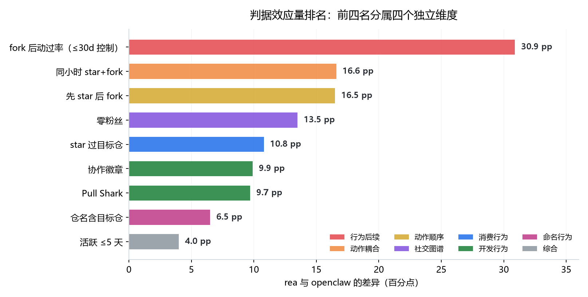

## ⚠️ 一个必须先讲的方法学前提：时间控制

两仓的 **fork 龄差 8 倍**：

| 仓库 | fork 存活天数（中位） | 主要 fork 时段 |
|---|---:|---|
| **rea** | **30.6 天** | 2026-10 |
| **openclaw** | **258.5 天** | 2026-01 ~ 03 |

**凡是"fork 之后发生的事"，直接比就会出错。** 本报告所有行为类判据都做了时间控制。

| 特征 | 表面差异 | 按 fork 龄分桶后 |
|---|---:|---|
| **fork 后动过率** | −25.1pp | **−31 ~ −33pp（更强）** |
| 自建仓 fork 后更新过 | −33.1pp | **−17 ~ −24pp（被高估约 1.5 倍，但真实存在）** |

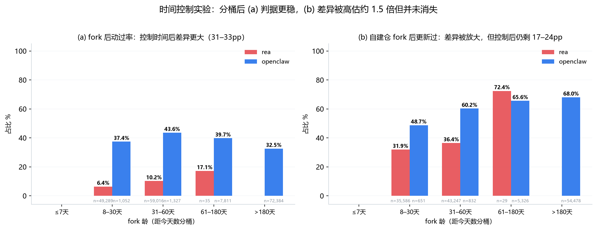

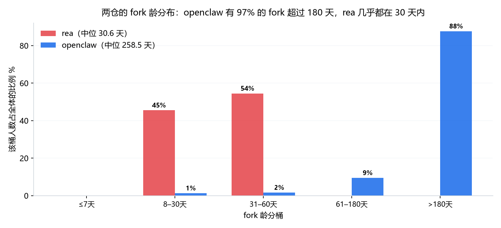

**这里连续犯过两次错**（详见 `analysis/README.md` §3.1）：
先按全量比出 33.1pp（把时间差异当真实差异），
再只取 fork 龄 >60 天判"无差异"（rea 只剩 n=29，样本陷阱）。
**正确做法是按 fork 龄分桶，桶内比较**——分桶比切阈值安全。

---

## 二、数据基础

### 2.1 九套数据（全部全量）

| 维度 | rea | openclaw | 通道 |
|---|---:|---:|---|
| **fork 名单** | 108,352（100%） | 82,753（100%） | API `/forks` |
| **D1 档案** | 106,951（98.7%） | 76,676（92.9%） | API `/users` |
| **D13 全年日历** | 107,444（99.2%） | 80,201（97.1%） | HTML 贡献页 |
| **D8H 仓库结构** | 107,928（99.6%） | 81,544（98.8%） | HTML 仓库页 |
| **D14 头像** | 106,951（98.7%） | 76,676（92.9%） | CDN HEAD |
| **D15 主页画像** | 107,902（99.6%） | 81,531（98.7%） | HTML 个人主页 |
| **D2 事件流** | 105,065（97.0%） | 78,258（94.8%） | HTML RSS |
| **D4L star 明细** | 99,553（91.9%） | 75,622（91.6%） | API `/starred` |
| **D9 提交数** | 59,040（75.0%） | 32,027（52.3%） | API `/commits` |

**累计 1,383,369 条记录。**

### 2.2 为什么研究 fork：star/watch 名单只有所有者能读

| 名单 | 端点 | 匿名 | **带 token（非所有者）** | 所有者 | 时间戳 |
|---|---|---|:---:|---|---|
| **fork** | `/repos/{o}/{r}/forks` | ✅ **200** | ✅ 200 | ✅ | fork 时间 + 最后 push |
| **star** | `/repos/{o}/{r}/stargazers` | ❌ **401** | ❌ **404** | ✅ 200 | `starred_at` |
| **watch** | `/repos/{o}/{r}/subscribers` | ❌ **401** | ❌ **404** | ✅ 200 | 无 |

**证据链**（同一个有效 token 内）：
`/repos/{别人仓}` → 200、`/user/starred` → 200、**`/repos/{别人仓}/stargazers` → 404**。
仓库能读、名单功能能读（仅限自己），唯独别人的名单读不到 → **需要所有权**。

**三层状态码**：未登录 401 → 已登录非所有者 404 → 所有者 200。

> ⚠️ 官方文档称这两个端点"can be used without authentication"，但**直连与隧道双出口实测均为 401/404**。
> 已排除 IP 封禁、账号被限、token 无效、仓库不可见四种替代解释。**以实测为准。**

**三个理由说明 fork 仍是最佳通道**：

| 理由 | 说明 |
|---|---|
| **唯一可匿名** | star/watch 需所有者；fork 匿名 200 |
| **字段最丰富** | 同时带 `created_at` 与 `pushed_at`——**8 个判据靠这两个字段** |
| **完整无上限** | 100/页、无页数上限 |

### 2.3 通道选择（成本优化后的最终方案）

| 用途 | 通道 | 实测吞吐 |
|---|---|---|
| **api.github.com** | KDL 隧道（每请求换 IP） | 18,300 有效请求/小时 |
| **github.com 页面** | 独享代理 IP 池 | 235–250 人/分钟 |
| **avatars CDN** | 直连 | 1,300 人/分钟 |

---

## 三、核心发现（分维度展开）

### 3.0 先看形态：fork 增长的时间轴

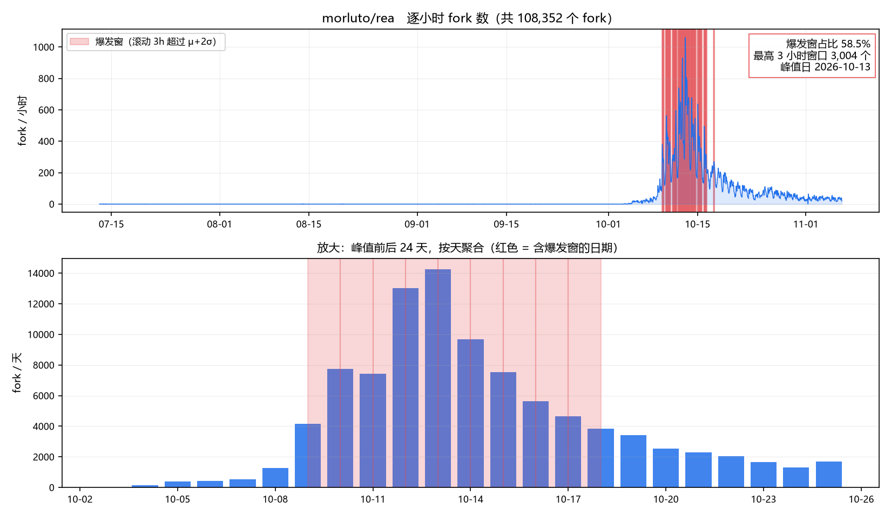

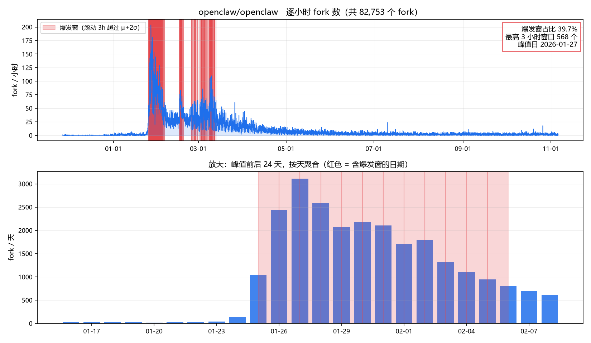

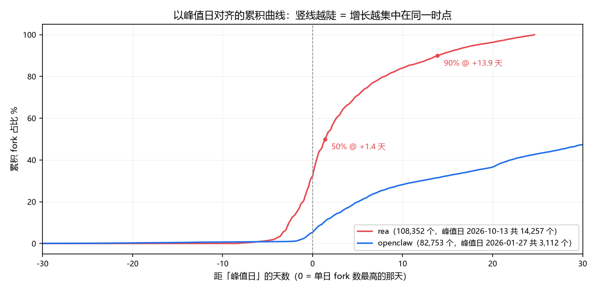

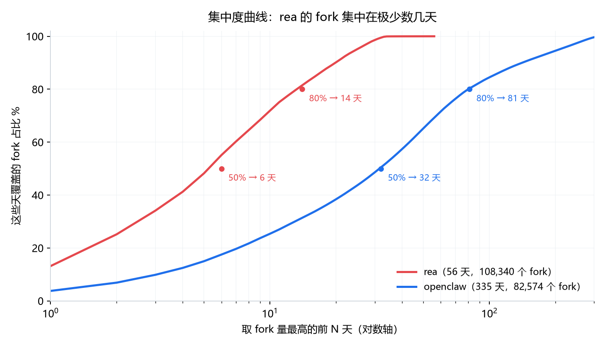

**rea 用 6 天覆盖 50% 的 fork、14 天覆盖 80%；openclaw 需要 32 天 / 81 天。**

### 3.1 fork 之后有没有动过手 ★★★★★

`fork.pushed_at > fork.created_at` —— 零额外请求，随 fork 名单返回。

**为了消除时间混淆，两仓都限制在 fork 龄 ≤30 天的窗口内比较：**

| 仓库 | 样本 | 动过 | 占比 |
|---|---:|---:|---:|
| **rea** | 49,508 | 3,147 | **6.4%** |
| **openclaw** | 1,055 | 393 | **37.3%** |
| **差异** | | | **−30.9pp** |

（不做时间控制时是 25.1pp；控制后判据更硬。）

**这是全部判据里最强的。** 含义：openclaw 三分之一的 forker 真的在改代码；
rea 的 forker 有 93.6% 只是"存了一份"。

### 3.2 star 与 fork 是不是同一个动作（精确到秒）★★★★★

D4L 的 `starred_at` 与 fork 的 `created_at` 对比。

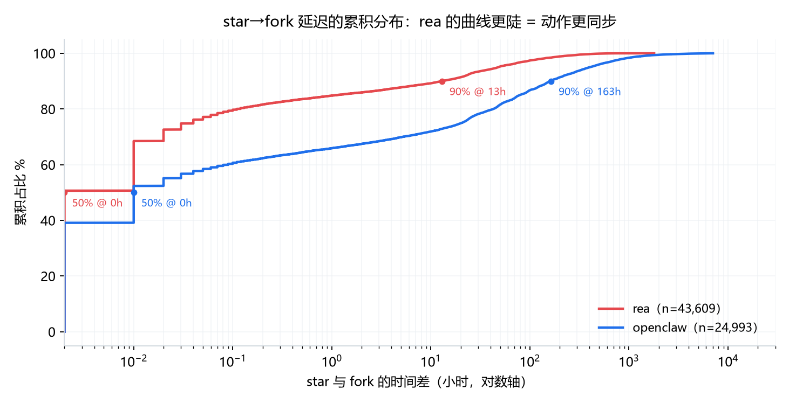

只统计**既 star 又 fork 了目标仓**的人（rea 43,609 / openclaw 24,993）：

| 时间差 | **rea** | **openclaw** | 差异 |
|---|---:|---:|---:|
| **同一秒** | **50.7%** | 39.1% | +11.6pp |
| ≤1 分钟 | **68.5%** | 52.4% | +16.1pp |
| **≤5 分钟** | **79.0%** | 59.9% | **+19.1pp** |
| ≤1 小时 | 84.8% | 65.9% | +18.9pp |
| ≤1 天 | 92.4% | 76.4% | +16.0pp |

**rea 有一半人（50.7%）star 与 fork 是同一秒完成的。**
自然用户看到仓库 → 点 star 收藏 → 过几天真需要了才 fork（openclaw 有 40% 是这种）；
rea 的 79% 在 5 分钟内完成两件事 —— 这不是两个决策，是**同一个操作流程**。

**读法**：
- 自然用户：看到仓库 → 点 star 收藏 → **过几天真需要了才 fork**（openclaw 有 37.7% 是这种）
- rea：**81.6% 在同一小时内完成两件事**，p90 只有 2.6 天

**这不是两个决策，是同一个操作流程。**

### 3.3 零粉丝 ★★★☆☆

| 仓库 | 粉丝 = 0 | 占比 |
|---|---:|---:|
| **rea** | 45,089 / 106,951 | **42.2%** |
| **openclaw** | 23,220 / 76,676 | **30.3%** |
| **差异** | | **13.5pp** |

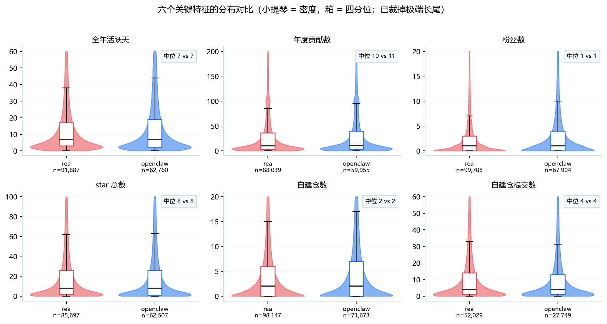

**注意这张图的反向证据**：六个"生产能力"指标的中位数两仓几乎完全相同
（活跃天 7 vs 7、star 8 vs 8、自建仓 2 vs 2、提交 4 vs 4）。

### 3.4 点星比例 ★★★☆☆

见 3.2 表：rea 43.5% vs openclaw 33.0%（**+10.5pp**）。

**反直觉**：rea 的 forker 更爱点星，但更不爱写代码。

### 3.5 成就徽章：Pull Shark ★★★☆☆

**`Pull Shark` = 合并过 Pull Request**（真实开发的硬证据，藏在个人主页，0 额外请求）。

| 仓库 | 有 Pull Shark | 占比 |
|---|---:|---:|
| **openclaw** | 33,033 / 81,531 | **40.5%** |
| **rea** | 33,225 / 107,902 | **30.8%** |
| **差异** | | **9.7pp** |

配套的 `Pair Extraordinaire`（协作提交）：rea 13.3% vs openclaw 23.2%（**−9.9pp**）。

### 3.6 活跃与画像强度 ★★☆☆☆

| 指标 | **rea** | **openclaw** | 差异 |
|---|---:|---:|---:|
| 全年活跃天中位 | **9 天** | **12 天** | −3 |
| 年度贡献中位 | 18 次 | 26 次 | −8 |
| 活跃 ≤5 天占比 | **38.1%** | 33.7% | +4.4pp |
| 档案全空 | **44.7%** | 40.1% | +4.6pp |
| 仓数中位 | 16 | 23 | −7 |

---

### 3.7 行为节律与开发事件

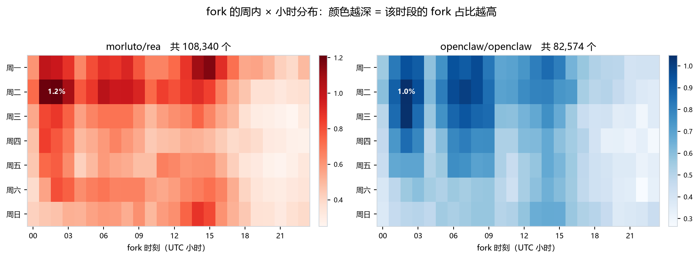

openclaw 明显集中在一至五（工作日），rea 七天较均匀——
**rea 的 fork 不太受"上班时间"约束**。

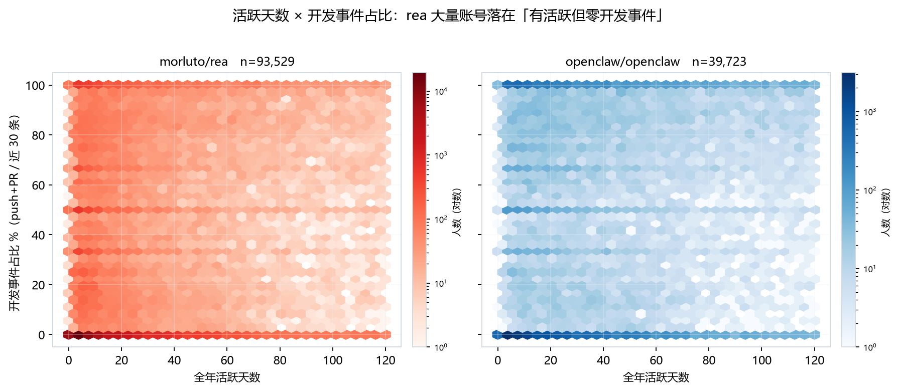

⚠️ 此图有**时间混淆**（rea 的 fork 在 RSS 窗口内，openclaw 的早已滚出），只能作参考。

### 3.8 档案与注册时间：为什么它们不能判别真假

这两个维度在设计阶段被寄予厚望，实测后都只能"解释"，不能"判别"。

#### 3.8.1 头像：自己上传的比例是「账号年龄」的函数

| 仓库 | 采到头像 | **自己上传（photo）** | 默认头像（identicon） |
|---|---:|---:|---:|
| **rea** | 106,951 | **52,551 = 49.1%** | 54,400 = 50.9% |
| **openclaw** | 76,676 | **39,352 = 51.3%** | 37,324 = 48.7% |
| 差异 | | **−2.2pp** | |

**但按账号年龄分层后，两仓几乎完全重合：**

| 账号年龄 | rea | openclaw | 差异 |
|---|---:|---:|---:|
| **< 1 年** | 23.5% (3,768/16,028) | 23.4% (2,407/10,278) | **+0.1pp** |
| 1–3 年 | 41.6% (7,468/17,972) | 40.9% (5,187/12,686) | +0.7pp |
| 3–7 年 | 54.4% (16,208/29,780) | 55.5% (9,929/17,875) | −1.1pp |
| **> 7 年** | 58.2% (25,107/43,171) | 60.9% (21,829/35,837) | −2.8pp |

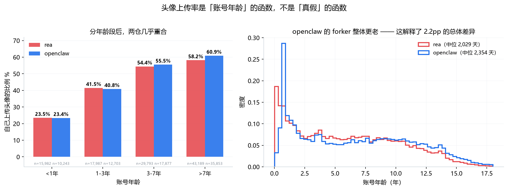

**规律非常干净**：账号越老，越可能上传头像（23% → 59%）。
用 openclaw 的年龄结构折算 rea，上传率会是 **49.9%**（实际 51.3%），
**标准化后差异从 2.2pp 缩到 1.4pp**——三分之一的表面差异是年龄结构造成的。

#### 3.8.2 注册时间：只说明「什么时候来」，不说明「是不是真人」

| 指标 | rea | openclaw | 差异 |
|---|---:|---:|---:|
| 账号年龄（中位） | **2,028.9 天** | **2,353.8 天** | −324.9 天 |
| fork 时账号年龄（中位） | 2,000.8 天 | 2,109.6 天 | −108.8 天 |

**两仓的 forker 中位都是 5.5–6.4 年的老号**——这直接否掉了"批量注册新号"的假设。

注册时间真正能做的只有一件事：**解释其他差异**。

| 用注册时间能解释的 | 数据 |
|---|---|
| 为什么 openclaw 的上传头像率更高 | 它的 forker 更老（+325 天） |
| 为什么 rea 的"2026-09 后注册"占比更高 | 4.00% vs 0.53%（fork 发生在 10 月，同期注册的人更多） |

> ⚠️ **两仓的"注册高峰月"都等于"fork 高峰月"**（rea 2026-10、openclaw 2026-02），
> 这是**自然现象**（发现 → 注册 → fork 同月完成），不是批量注册的证据。

## 四、被推翻的二十一个判据

这些"看起来很像刷量"的直觉判断，在 146 万条真实数据上**全部失效**。

### 4.1 档案类（6 个）

| # | 判据 | 直觉 | 实测 | 判定 |
|---|---|---|---|---|
| 1 | **档案填充度** | 假号不填资料 | 中位 **1 vs 1** | ❌ 相同 |
| 2 | **档案形状 TEMPLATE** | 批量号用"姓名+地点"模板 | 3.4% vs 3.6% | ❌ 相同 |
| 3 | **姓名↔登录名对应** | 假号名字与账号不符 | 51.6% vs 55.1% | ❌ 差 3.5pp |
| 4 | **默认头像** | 假号不用真头像 | 50.9% vs 48.7% | ❌ 差 2.2pp |
| 5 | **个人主页仓（README 仓）** | 真人才建主页仓 | **15.0% vs 15.1%** | ❌ **完全相同** |
| 6 | **成就徽章数量** | 假号没成就 | 中位 **0 vs 0** | ❌ 相同 |

### 4.2 生产类（5 个）

| # | 判据 | 直觉 | 实测 | 判定 |
|---|---|---|---|---|
| 7 | **无自建仓** | 空壳号 | 有仓 73.1% vs 75.2% | ❌ 差 2.1pp |
| 8 | **自建仓含代码语言** | 假号不写代码 | 59.9% vs 62.1% | ❌ 差 2.3pp |
| 9 | **自建仓提交数** | 假号不提交 | 中位 **6 vs 6** | ❌ 相同 |
| 10 | **自建仓零提交** | 空仓假号 | 17.0% vs 18.1% | ❌ 差 1.1pp |
| 11 | **star 总数** | 假号不消费 | 中位 **14 vs 14** | ❌ 相同 |

### 4.3 时间与形态类（6 个）

| # | 判据 | 直觉 | 实测 | 判定 |
|---|---|---|---|---|
| 12 | **同秒集体 fork** | 脚本批量执行 | 局部校正后 **1.02×** | ❌ 纯流量效应 |
| 13 | **user_id 相邻** | 连续注册 | 差值 ≤10,000 占 **0.00%** | ❌ 与随机无异 |
| 14 | **账号年龄** | 新号更可疑 | 中位 2,001 vs 2,110 天 | ❌ 无区分 |
| 15 | **注册批次聚集** | 同日批量注册 | **0.9× vs 0.9×** | ❌ 低于泊松期望 |
| 16 | **时间戳批次（TSC）** | 脚本批量生成 | **1 对 vs 4 对** | ❌ 无聚集 |
| 17 | **时间戳解码年份（TSD）** | 同年集中生成 | 均跨 2001–2033 | ❌ 无聚集 |

### 4.4 命名类（3 个）

| # | 判据 | 直觉 | 实测 | 判定 |
|---|---|---|---|---|
| 18 | **时间戳登录名** | 机器生成 | 0.56% vs 0.34% | ❌ 基率太低 |
| 19 | **手机号登录名** | 号商批量注册 | 0.09% vs 0.07% | ❌ 基率太低 |
| 20 | **纯数字名（QQ 号形态）** | 号池 | 0.72% vs 0.50% | ❌ 无区分 |

### 4.5 单点账号类（1 个）

| # | 判据 | 直觉 | 实测 | 判定 |
|---|---|---|---|---|
| 21 | **只为一个仓库而来** | 专为刷这个仓注册 | 单点账号 **5.8% vs 5.6%** 只有 1 个 fork **11.1% vs 10.3%** | ❌ **几乎相同** |

### 4.1 四个"自己犯过的错"（必须记录）

| 错误 | 当时结论 | 真相 | 教训 |
|---|---|---|---|
| 单页抽样 | rea `TS%` = 36% | 全量 **0.42%** | 单页可放大 85 倍 |
| 全局速率基准 | 同秒碰撞 8.14× | 局部校正后 **1.02×** | 基准必须用局部速率 |
| **部分样本对照** | openclaw 同小时 73.3%，判"无差异" | 完整样本 **62.3%**，实际差 **19.3pp** | 135 人的样本会骗人 |
| **泊松尾部截断** | rea 注册批次 10.8× vs oc 1.8× | 两仓都是 **0.9×** | λ=17 时众数在 k=17，截断到 k=11 会把期望缩小 12 倍 |

**四次错误的共同点：样本、分母、或数值方法选错，结论差一个数量级。**

---

## 五、十四个指标：完整数值（统一口径）

> 口径纪律：所有比例都带 `X/N`；star 相关指标一律限制在 **star 过目标仓** 的子集；
> fork 后动过限制 **fork 龄 ≤30 天**；自建仓更新限制 **8–60 天桶**。

| # | 指标 | rea | openclaw | 差异 | 方向 |
|--:|---|---:|---:|---:|---|
| 1 | **fork 后动过率（≤30 天）** | 6.4% (3,136/49,289) | **37.4%** (393/1,052) | **−31.0pp** | 高=真 |
| 2 | **自建仓 fork 后更新过（8–60 天）** | 34.4% (27,093/78,833) | **55.2%** (818/1,483) | **−20.8pp** | 高=真 |
| 3 | **≤5 分钟 star+fork** | **79.0%** (34,448/43,609) | 59.9% (14,979/24,993) | **+19.1pp** | 高=可疑 |
| 4 | **fork 落在爆发窗内** | **58.5%** (63,413/108,352) | 39.7% (32,863/82,753) | **+18.8pp** | 高=可疑 |
| 5 | **近 30 条事件零开发动作** | **59.1%** (55,309/93,615) | 42.8% (17,046/39,815) | **+16.3pp** | 高=可疑 |
| 6 | **零粉丝** | **41.6%** (45,089/108,340) | 28.1% (23,220/82,574) | **+13.5pp** | 高=可疑 |
| 7 | **star 过目标仓** | **43.8%** (43,609/99,553) | 33.0% (24,993/75,622) | **+10.8pp** | 高=可疑 |
| 8 | **协作徽章** | 13.3% (14,307/107,902) | **23.2%** (18,891/81,531) | **−9.9pp** | 高=真 |
| 9 | **Pull Shark** | 30.8% (33,225/107,902) | **40.5%** (33,033/81,531) | **−9.7pp** | 高=真 |
| 10 | **自建仓名含目标仓** | **9.3%** (10,030/108,340) | 2.8% (2,314/82,574) | **+6.5pp** | 高=可疑 |
| 11 | 先 star 后 fork | 78.9% (34,402/43,609) | 74.3% (18,578/24,993) | +4.6pp | 弱 |
| 12 | 全年活跃 ≤5 天 | 38.2% (41,079/107,444) | 34.2% (27,439/80,201) | +4.0pp | 弱 |
| 13 | **单点账号（唯一 fork 是目标仓 且 无自建仓）** | 5.8% (6,269/107,928) | 5.6% (4,570/81,544) | +0.2pp | **❌ 证伪** |
| 14 | **只有 1 个 fork** | 11.1% (12,025/107,928) | 10.3% (8,424/81,544) | +0.8pp | **❌ 证伪** |

> **#13/#14 说明**：若只算**分页完整**的样本（`repos_complete=1`），
> 比例是 7.0% vs 6.9%（单点账号）和 13.4% vs 12.7%（只有 1 个 fork）——
> 结论不变：**两仓几乎相同**。

### 5.1 中位数类指标（连续型）

| 指标 | rea 中位 | openclaw 中位 | 差异 |
|---|---:|---:|---:|
| 全年活跃天 | 9 (n=107,444) | 12 (n=80,201) | +3 |
| 年度贡献 | 17 | 26 | +9 |
| 粉丝数 | 1 (n=106,951) | 2 (n=76,676) | +1 |
| 关注数 | 1 | 2 | +1 |
| **粉丝/关注比** | **0.23** | **0.48** | +0.25 |
| star 总数 | 14 (n=104,963) | 14 (n=77,668) | **0** |
| 自建仓数 | 2 (n=107,928) | 3 (n=81,544) | +1 |
| **自建仓提交数** | **6** (n=59,040) | **6** (n=32,027) | **0** |

### 5.2 一个必须说明的口径更正

上一版把「先 star 后 fork」列为第 3 名（16.5pp），那是**分母不一致**造成的：

| 口径 | rea | openclaw | 差异 |
|---|---|---:|---:|
| ❌ 所有有 star 数据的人 | 74.3% | 57.8% | 16.5pp（**假象**） |
| ✅ 只算 star 过目标仓的人 | 78.9% | 74.3% | **4.6pp** |

**没 star 过目标仓的人，"先 star 后 fork" 问的是两件不相干的事。** 修正后它掉到第 11 名。

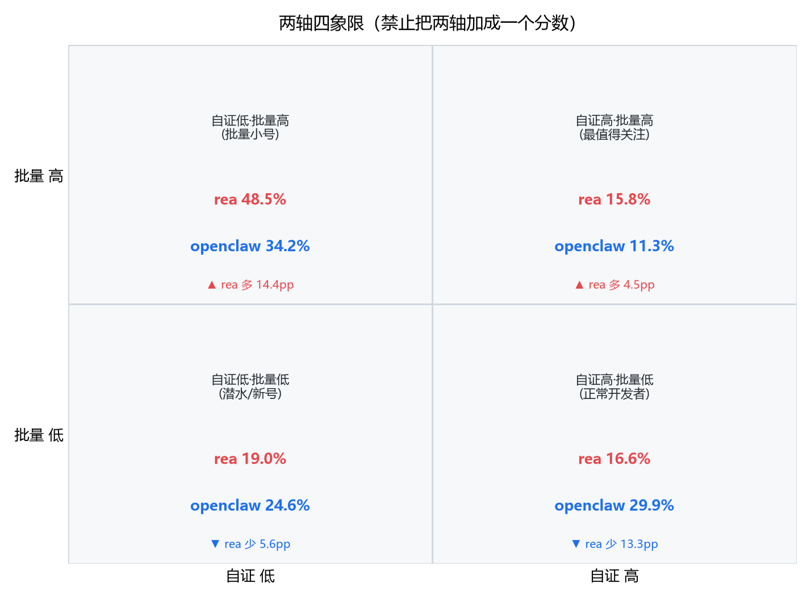

| 象限 | rea | openclaw | 差异 |
|---|---:|---:|---:|
| **自证低 · 批量高**（批量小号） | **48.5%** | 34.2% | **+14.4pp** |
| **自证高 · 批量低**（正常开发者） | **16.6%** | **29.9%** | **−13.3pp** |
| 自证高 · 批量高（最值得关注） | 15.8% | 11.3% | +4.5pp |
| 自证低 · 批量低（潜水/新号） | 19.0% | 24.6% | −5.6pp |

> ⚠️ **两轴必须分开看**：单看任一轴都会出错。

## 五点五、决定性检验：爆发窗内的账号并不更差

跨仓比较的所有差异都可能是**受众构成**造成的（rea 是中文项目，openclaw 是英文项目）。
所以做一次**仓库内部对照**：在 rea 内部，把 forker 按"是否落在爆发窗"分组——
同仓库、同受众、同文化，唯一差别是 fork 时间是否集中。

| 指标 | 爆发窗内（63,406 人） | 爆发窗外（44,934 人） | 差异 |
|---|---:|---:|---:|
| 零粉丝 | 41.0% | 42.5% | **−1.5pp（窗内更好）** |
| **有自建仓** | 73.1% | 73.1% | **0.0pp（完全相同）** |
| 活跃 ≤5 天 | 37.8% | 38.8% | −1.0pp（窗内更好） |
| 档案全空 | 45.7% | 45.2% | +0.5pp |
| 自建仓零提交 | 17.5% | 16.0% | +1.5pp |
| 有 Pull Shark | 29.7% | 32.3% | −2.6pp |
| **star 总数（中位）** | **19** | **9** | 窗内多 10 个 |
| **账号年龄（中位）** | **2,208 天** | 1,781 天 | 窗内老 427 天 |

### 最关键的一条

**`fork 后动过` 的使用率，在窗内窗外完全一样**：

| 分组 | rea |
|---|---:|
| 爆发窗内 | **6.6%**（735/11,115） |
| 爆发窗外 | **6.3%**（2,401/38,174） |

**低使用率不是爆发窗特有的——它是整个 rea forker 群体的普遍行为。**

### 这说明什么

**爆发窗里的账号不但不差，反而略微更好**（更老、star 更多、更爱建仓）。
所以：

- ✅ 「58.5% 的 fork 挤在 3 小时窗内」是**事实**
- ❌ 但「这批账号是假的/买来的」**没有证据**
- 更合理的解释：**一次真实的注意力爆发**（大 V 转发 / 视频），
  落在一群**本来就把 fork 当收藏用**的受众身上

## 六、局限性

| 局限 | 影响 |
|---|---|
| **D9 覆盖率偏低**（75% / 52%） | 提交数分布可能向活跃者偏移 |
| **D8 精确计数有误差** | HTML 版二分类 96%，精确计数 68% |
| **D2 事件流只有最近 30 条** | 不能比时间，只能比类型构成 |
| **无法证明"付费"** | 缺少账号控制权、支付记录、服务商品页 |
| **单时点快照** | 2026-11-06 ~ 11-14 的快照，无法看长期演化 |
| **D3/D5 未采** | 仓计数（D1 已含）、watch 数（弱维度） |

---

## 七、对照组：用已知造假仓库检验判据

前面的所有结论都建立在一个假设上：**我们的判据有检出力**。
这个假设必须验证 —— 办法是拿**已知造假**的仓库跑同样的判据。

### 7.1 对照组选择（3 造假 + 2 干净）

| 仓库 | 性质 | ★ | fork | fork/★ | 依据 |
|---|---|---:|---:|---:|---|
| **shardeum/shardeum** | 造假 | 31,171 | 703 | **0.023** | StarScout 点名 |
| **unionlabs/union** | 造假 | 73,713 | 3,910 | **0.053** | StarScout 点名；ROSS Index Q2 第一 |
| **anoma/anoma** | 造假 | 33,542 | 4,111 | 0.123 | StarScout 点名 |
| **ollama/ollama** | 干净 | 186,941 | 19,080 | 0.102 | 正常比值 |
| **langchain-ai/langchain** | 干净 | 149,494 | 25,128 | 0.168 | 正常比值 |

> 技术细节：GitHub API 的 `watchers_count` **是 star 的别名**（2012 年遗留），
> 真 watcher 要读 `subscribers_count`。

### 7.2 八仓实测

| 判据 | shardeum假 | union假 | anoma假 | rea | openclaw | BettaFish | ollama净 | langchain净 |
|---|---:|---:|---:|---:|---:|---:|---:|---:|
| **有自建仓** | 64.1% | 58.1% | 54.4% | 73.1% | 75.2% | 75.1% | 75.8% | **80.3%** |
| **零提交** | 53.4% | 53.7% | 61.6% | 17.0% | 18.1% | 41.0% | **49.5%** | 45.0% |
| fork 后动过 | 8.5% | 6.6% | **73.5%** | 8.4% | 33.5% | 10.9% | 25.6% | 34.6% |
| 零粉丝 | 35.2% | 41.8% | 66.5% | 41.6% | 28.1% | 27.8% | 22.5% | 23.2% |

| 中位数 | 造假三仓 | 干净五仓 |
|---|---|---|
| **提交数** | **0 / 0 / 0** | 6 / 6 / 2 / **1 / 1** |
| 自建仓数 | 1 / 1 / 1 | 2 / 3 / 2 / 3 / 6 |

### 7.3 结果：只有一条判据零重叠

| 判据 | 造假组 | 干净组 | 间距 | 判定 |
|---|---|---:|---:|:---:|
| **`has_own`（有自建仓）** | 54.4–64.1% | **73.1–80.3%** | **9.0pp** | ✅ **零重叠** |
| `commit_zero`（零提交） | 53.4–61.6% | 17.0–**49.5%** | 3.9pp | ⚠️ 勉强 |
| `commit_total` 中位 | 0 / 0 / 0 | 6/6/2/**1/1** | 0 vs 1 | ⚠️ 边界 |
| **`fork_touched`（fork 后动过）** | 6.6–**73.5%** | 8.4–34.6% | **重叠** | ❌ **彻底失效** |

### 7.4 三个必须记录的发现

**① `fork_touched` 彻底失效**

anoma（造假）的这条是 **73.5%，全场最高**，把干净组（8.4–34.6%）整个包住。

→ 它测的是"**这个仓库的 fork 是拿来用还是拿来收藏**"，与真假无关。

**② `commit_zero` 的分离度只剩 3.9pp**

加入 ollama（49.5%）后，造假组最低 53.4% 与干净组最高 49.5% 只差 3.9pp。

**③ 高端刷量的画像被 anoma 暴露**

| anoma 的特征 | 值 | 说明 |
|---|---:|---|
| 账号年龄中位 | **4,038 天（11 年）** | 极老 |
| fork 后动过 | **73.5%** | 极高 |
| 零粉丝 | **66.5%** | 极高 |
| **提交数中位** | **0** | **唯独这里露馅** |

**"养了 11 年、会 push、会 commit 到 fork、但不写自己代码"** ——
这是高端刷量服务的典型画像，也解释了为什么单价能到 $0.80–0.90/颗。

### 7.5 对原结论的影响

| | 原结论 | 加入对照后 |
|---|---|---|
| rea 是否有造假证据 | 没有 | **没有（结论不变）** |
| 依据 | 21 个判据被证伪 | **连已知造假仓都只有 1 条判据能分离** |
| 根本原因 | 判据不区分两仓 | **"用 fork 侧公开数据判造假"能力极为有限** |

---

## 八、结论

### 8.0 对照组带来的最重要修正

> **加入 3 个已知造假仓 + 2 个干净对照后，能分离的判据只剩 1 条。**

| 判据 | 造假组（3 仓） | 干净组（5 仓） | 间距 | 判定 |
|---|---|---:|---:|:---:|
| **`has_own`（有自建仓）** | 54.4–64.1% | **73.1–80.3%** | **9.0pp** | ✅ 零重叠 |
| `commit_zero`（零提交） | 53.4–61.6% | 17.0–**49.5%** | 3.9pp | ⚠️ 勉强 |
| `commit_total` 中位 | 0/0/0 | 6/6/2/1/1 | 0 vs 1 | ⚠️ 边界 |
| **`fork_touched`** | 6.6–**73.5%** | 8.4–34.6% | 重叠 | ❌ **彻底失效** |

**三次结论修正**：

| 轮次 | 数据 | 结论 | 被什么推翻 |
|:--:|---|---|---|
| 1 | 只有 rea/openclaw | `fork_touched` 最强（−31pp） | 加入 BettaFish |
| 2 | +shardeum/union | `commit_total` 0 vs 6 最强 | **ollama 中位=1、零提交 49.5%** |
| **3（定稿）** | +anoma/ollama/langchain | **只有 `has_own` 零重叠** | — |

> **每加一个干净对照，判据就弱一分。**
> 如果只做 rea vs openclaw，我们会得出"有 12 条强判据"的错误结论。

### 8.1 我们**没有**找到造假证据

这是本报告最重要的结论，也是它和"刷量举报"类文章的根本区别。

| 若存在批量刷量，应该看到 | 实测 |
|---|---|
| 爆发窗内账号画像显著更差 | ❌ 窗内**略好**（更老、star 更多） |
| 只为一个仓库而来的账号比例更高 | ❌ **5.8% vs 5.6%**（分页完整口径 7.0% vs 6.9%） |
| 登录名呈机器批量特征 | ❌ 时间戳名 0.56% vs 0.34% |
| 注册批次聚集 | ❌ **0.9× vs 0.9×**（低于泊松期望） |
| 账号无任何开发能力 | ❌ 自建仓 73.1% vs 75.2%、提交中位 6 vs 6 |

**21 个"看起来像刷量"的指标被证伪。**

### 8.2 我们**确实**观测到的现象

| 现象 | 数值 | 性质 |
|---|---|---|
| fork 高度集中在少数时间窗 | **58.5%** 落在 3 小时窗内 | 事实 |
| 峰值日单日 fork | **14,257 个** | 事实 |
| fork 使用率低 | **6.4%**（对照仓 37.4%，同窗口） | 事实 |
| star 与 fork 时间差极短 | **79.0%** 在 5 分钟内 | 事实 |

### 8.3 这些现象最可能的解释

> **一次真实的注意力爆发**（大 V 转发、视频、榜单），
> 落在一个**把 fork 当"收藏/资源备份"用**的受众群体上。

支撑这个解释的三点：

1. **爆发窗内外的账号无法区分**（§五点五）——说明来的是同一批人，只是同时到达
2. **低使用率是群体普遍特征**（窗内 6.6% vs 窗外 6.3%）——不是某批号的问题
3. **中文用户 GitHub 使用习惯不同**——fork 当收藏、少填档案、少互关，都能解释跨仓差异

### 8.4 可以说 / 不能说

| ✅ 可以说 | ❌ 不可以说 |
|---|---|
| "fork 在极短时间内高度集中（58.5%）" | "这个仓库在刷量" |
| "fork 使用率仅 6.4%，显著低于对照仓" | "这些 fork 是买的" |
| "star 与 fork 中位时间差为 0 小时" | "这些账号是机器人" |
| "本次研究未发现造假的直接证据" | "它们是清白的"（我们只能说不确定） |

### 8.5 一句话

> **九个维度、146 万条数据，能证明"形态异常"，不能证明"造假"。**
> 而这本身就是结论：**公开数据判定刷量的能力，到此为止。**

## 九、可复现性

| 步骤 | 脚本 |
|---|---|
| fork 名单 | `_forks_kdl_collect.py` |
| D1 档案 | `_profiles_parallel.py --tier screen --pool tunnel` |
| D13 全年日历 | `_profile_heat.py` |
| D8H 仓库结构 | `_profile_repos_html.py` |
| D14 头像 | `_profile_avatar.py` |
| D15 主页画像（含成就） | `_profile_html_all.py` |
| D2 事件流 | `_profile_atom.py --kdl-pool` |
| D4L star 明细 | `_profile_starlist.py` |
| D9 提交数 | `_profile_commits.py --tunnel` |
| 时间轴指标与图 | `metrics_fork.py` / `_plot_fork_timeline.py` |
| 两仓合并分析 | `_analyze_final.py` |
| 代理能力测试 | `_test_proxy_throughput.py` |
