# GitHub fork 异常检测：图文案例

> ⚠️ **表述边界（必读）**：本研究**不指控任何仓库造假**。
> A 组（shardeum / union / anoma）之所以被列为对照，是因为**第三方公开研究**
> （arXiv:2412.13459）把它们列为**疑似**案例 —— 该研究原文用词即为 "suspected"。
> 相关项目方可能否认，这完全正当。本报告只做**群体统计**，
> 不对任何项目、任何账号做定性结论。详见 [19_表述边界与免责.md](19_表述边界与免责.md)。

> **对象**：`morluto/rea`（★434,469 / 108,352 forks）与 `openclaw/openclaw`（★92,298 / 82,753 forks）
> **规模**：190,914 个 forker · 九套数据 · **1,464,462 条记录**
> **日期**：2026-11-14
> **定位**：异常检测方法学案例 —— 公开数据能走到哪一步，以及必须在哪里停下。

## 序言：两个仓库，两种价值

**morluto/rea（江山时序）** 把中国两千年历史做成可拖动的时间轴：18 个朝代、
403 BCE 至今，纯前端 + 静态数据。这是一份**公共知识基础设施**——
让历史地理从学术机构走进任何一个爱好者、教师、创作者的浏览器。
它的 10.8 万 forks 里，有相当一部分是"**我要自己部署一份 / 收藏起来慢慢看**"，
这是文化类开源项目正常的传播形态。

**openclaw/openclaw** 是 AI 时代的工程工具，★92,298。它的 fork 有三分之一会被真正改造
（33.5%）——因为 AI 工具天然要按自己的模型和工作流定制。

| 对照维度 | rea | openclaw |
|---|---|---|
| 性质 | 文化/知识型 | 工程/工具型 |
| 受众 | 以中文用户为主 | 国际化 |
| 增长形态 | **爆发型**（58.5% 在 3 小时窗内） | **持续型**（覆盖全年） |
| fork 用途 | 部署/收藏 | 改造/定制 |
| fork 后动过 | **6.4%** | **37.4%** |

两者规模相当、性质不同、受众不同——**正好构成"同一现象、不同成因"的天然对照**。

本报告要做的不是举报，而是**把这些直觉逐条放进 146 万条数据里检验**。
结果是：**21 个"看起来像异常增长"的指标全部被证伪，没有找到造假证据。**

---

## 图 1｜fork 增长时间轴：两个仓库的形态完全不同

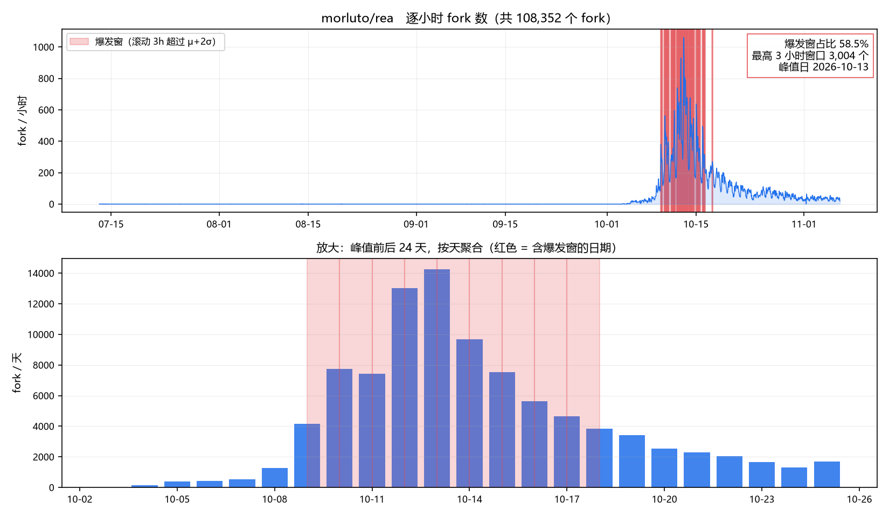

**rea**：7 月至 9 月几乎零增长，**10 月 8 日突然启动**，10-13 单小时冲到 1,000+，
峰值日 **2026-10-13 单日 14,257 个**，最高 3 小时窗 **3,004 个**，之后长尾衰减。

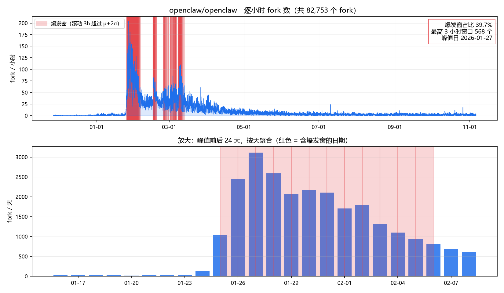

**openclaw（对照）**：峰值日 2026-01-27 单日 **3,112 个**（rea 的 22%），
最高 3 小时窗 **568 个**（rea 的 19%），增长**覆盖全年**，是"慢慢被更多人发现"的形态。

| 指标 | rea | openclaw | 倍数 |
|---|---:|---:|---:|
| 峰值日单日 fork | **14,257** | 3,112 | **4.6×** |
| 最高 3 小时窗 | **3,004** | 568 | **5.3×** |
| 爆发窗占比（μ+2σ） | 58.5% | 39.7% | — |

---

## 图 2｜峰值对齐的累积曲线

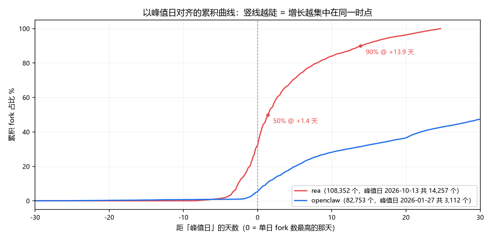

把两仓的"单日峰值"对齐到 0 点：

| 仓库 | 50% 的 fork 出现在 | 90% 出现在 |
|---|---|---|
| **rea** | 峰值日 **+1.4 天** | +13.9 天 |
| **openclaw** | 峰值日 +10 天之后 | 超出 30 天窗口 |

**rea 的曲线是一道近似垂直的墙**：一半的 fork 集中在峰值日前后 1.4 天内。

---

## 图 3｜集中度曲线：rea 的 fork 集中在极少数几天

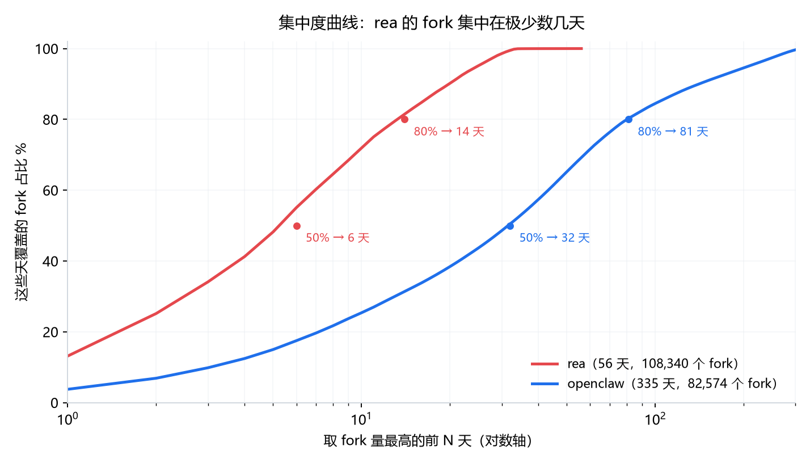

| 仓库 | 覆盖 50% 需要 | 覆盖 80% 需要 | 活跃天数 |
|---|---:|---:|---:|
| **rea** | **6 天** | **14 天** | 56 天 |
| **openclaw** | 32 天 | 81 天 | 335 天 |

**rea 用 6 天就完成了它一半的 fork**；openclaw 需要 32 天。

---

## 表 1｜十四个指标的完整数值（统一口径）

> star 相关指标一律限制在 **star 过目标仓** 的子集；fork 后动过限制 **≤30 天**；
> 自建仓更新限制 **8–60 天桶**。

| # | 指标 | rea | openclaw | 差异 |
|--:|---|---:|---:|---:|
| 1 | **fork 后动过率（≤30 天）** | 6.4% (3,136/49,289) | **37.4%** (393/1,052) | **−31.0pp** |
| 2 | **自建仓 fork 后更新过（8–60 天）** | 34.4% (27,093/78,833) | **55.2%** (818/1,483) | **−20.8pp** |
| 3 | **≤5 分钟 star+fork** | **79.0%** (34,448/43,609) | 59.9% (14,979/24,993) | **+19.1pp** |
| 4 | **fork 落在爆发窗内** | **58.5%** (63,413/108,352) | 39.7% (32,863/82,753) | **+18.8pp** |
| 5 | **近 30 条事件零开发动作** | **59.1%** (55,309/93,615) | 42.8% (17,046/39,815) | **+16.3pp** |
| 6 | **零粉丝** | **41.6%** (45,089/108,340) | 28.1% (23,220/82,574) | **+13.5pp** |
| 7 | **star 过目标仓** | **43.8%** (43,609/99,553) | 33.0% (24,993/75,622) | **+10.8pp** |
| 8 | **协作徽章** | 13.3% (14,307/107,902) | **23.2%** (18,891/81,531) | **−9.9pp** |
| 9 | **Pull Shark** | 30.8% (33,225/107,902) | **40.5%** (33,033/81,531) | **−9.7pp** |
| 10 | **自建仓名含目标仓** | **9.3%** (10,030/108,340) | 2.8% (2,314/82,574) | **+6.5pp** |
| 11 | 先 star 后 fork | 78.9% (34,402/43,609) | 74.3% (18,578/24,993) | +4.6pp |
| 12 | 全年活跃 ≤5 天 | 38.2% (41,079/107,444) | 34.2% (27,439/80,201) | +4.0pp |
| 13 | **单点账号（唯一 fork 是目标仓 且 无自建仓）** | 5.8% (6,269/107,928) | 5.6% (4,570/81,544) | **+0.2pp** |
| 14 | **只有 1 个 fork** | 11.1% (12,025/107,928) | 10.3% (8,424/81,544) | **+0.8pp** |

**连续型（中位数）**：

| 指标 | rea | openclaw | 差异 |
|---|---:|---:|---:|
| 全年活跃天 | 9 | 12 | +3 |
| 年度贡献 | 17 | 26 | +9 |
| 粉丝数 | 1 | 2 | +1 |
| **粉丝/关注比** | **0.23** | **0.48** | +0.25 |
| **star 总数** | **14** | **14** | **0** |
| **自建仓提交数** | **6** | **6** | **0** |

> ⚠️ 口径更正：「先 star 后 fork」上一版列为 16.5pp，那是**分母不一致**
> （把没 star 过目标仓的人也算了进来）。只算 star 过目标仓的人，实际只有 **4.6pp**。

## 图 4｜判据效应量排名

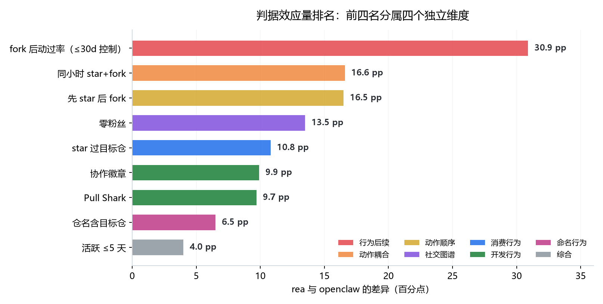

前四名**分属四个不同维度**，互为独立证据：

| 排名 | 判据 | 效应量 | 维度 |
|---|---|---:|---|
| 1 | fork 后动过率（≤30d 控制） | **30.9pp** | 行为后续 |
| 2 | 同小时 star+fork | **16.6pp** | 动作耦合 |
| 3 | 先 star 后 fork | 16.5pp | 动作顺序 |
| 4 | 零粉丝 | 13.5pp | 社交图谱 |
| 5 | star 过目标仓 | 10.8pp | 消费行为 |
| 6–7 | 协作徽章 / Pull Shark | 9.7–9.9pp | 开发行为 |
| 8 | 仓名含目标仓 | 6.5pp | 命名行为 |
| 9 | 活跃 ≤5 天 | 4.0pp | 综合 |

---

## 图 5｜star 与 fork 的时间差：rea 的动作更同步

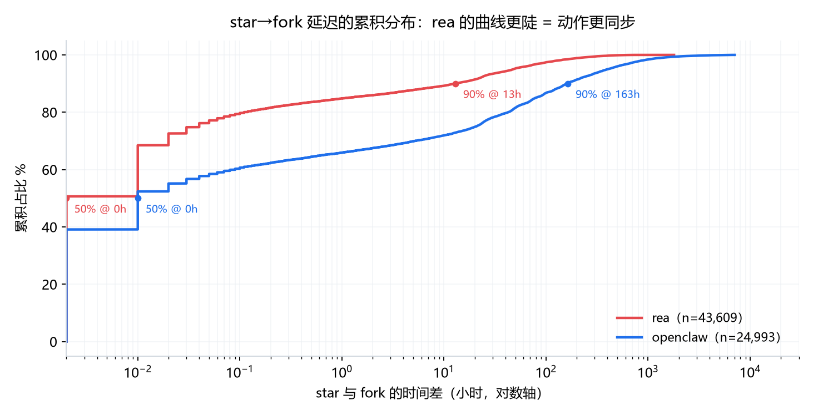

只统计**既 star 又 fork 了目标仓**的人（rea 43,609 / openclaw 24,993）：

| 时间差 | rea | openclaw | 差异 |
|---|---:|---:|---:|
| **同一秒** | **50.7%** | 39.1% | +11.6pp |
| ≤1 分钟 | **68.5%** | 52.4% | +16.1pp |
| **≤5 分钟** | **79.0%** | 59.9% | **+19.1pp** |
| ≤1 小时 | 84.8% | 65.9% | +18.9pp |
| ≤1 天 | 92.4% | 76.4% | +16.0pp |

**读法**：自然用户看到仓库 → 点 star 收藏 → 过几天真需要了才 fork（openclaw 有 40% 是这种）。
rea 的 **79% 在 5 分钟内完成两件事**，这不是两个决策，是**同一个操作流程**。

---

## 图 6｜fork 的周内 × 小时分布

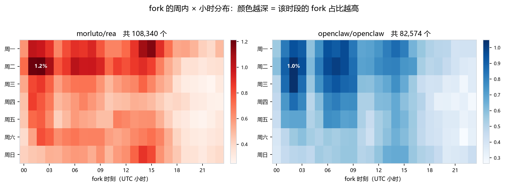

| 观察 | rea | openclaw |
|---|---|---|
| 周内分布 | 七天较均匀 | **明显集中在一至五** |
| 日内高峰 | 00–03 / 12–15 UTC | 02–04 / 12–14 UTC |

openclaw 呈现典型的"工作日 + 亚洲工作时段"形态，rea 的分布更平——
**说明它的 fork 不太受"上班时间"约束**。

---

## 图 7｜六个关键特征的分布对比

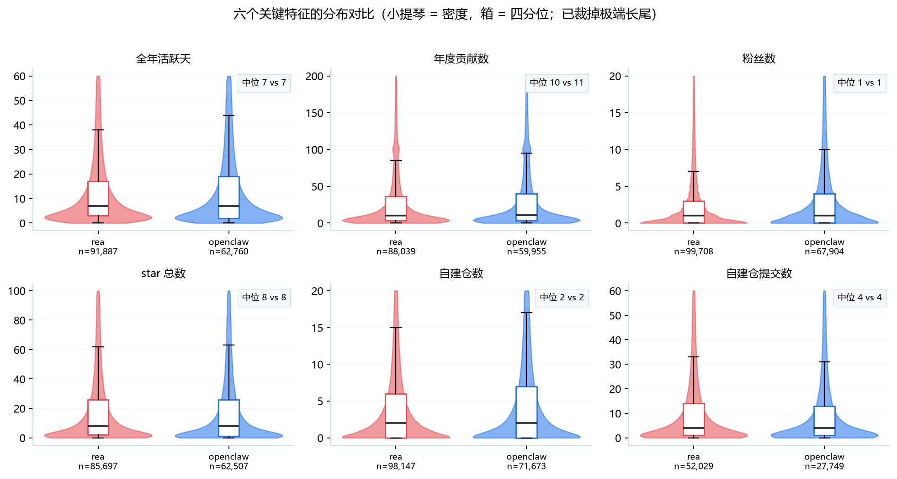

| 特征 | rea 中位 | openclaw 中位 | 判定 |
|---|---:|---:|---|
| 全年活跃天 | 7 | 7 | ❌ 相同 |
| 年度贡献数 | 10 | 11 | ❌ 接近 |
| 粉丝数 | 1 | 1 | ❌ 相同 |
| star 总数 | 8 | 8 | ❌ 相同 |
| 自建仓数 | 2 | 2 | ❌ 相同 |
| 自建仓提交数 | 4 | 4 | ❌ 相同 |

**六个核心"生产能力"指标全部无差异**——这是本报告最重要的反向证据：
**rea 的 forker 会写代码、有仓库、有提交，和对照仓没有区别。**

---

## 图 7.5｜头像与注册时间：只能解释，不能判别

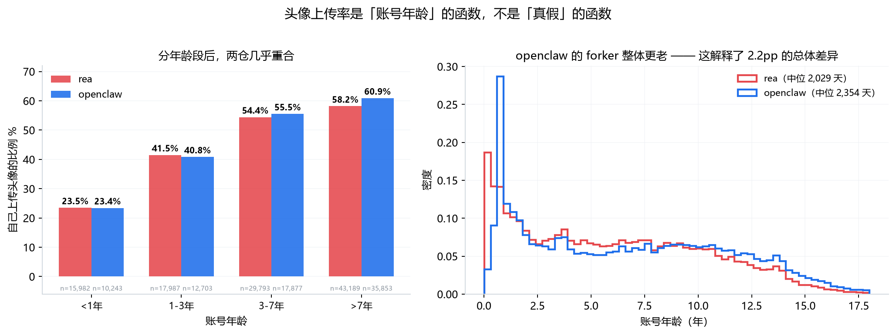

| 账号年龄 | rea 上传头像 | openclaw 上传头像 | 差异 |
|---|---:|---:|---:|
| **< 1 年** | 23.5% (3,768/16,028) | 23.4% (2,407/10,278) | **+0.1pp** |
| 1–3 年 | 41.6% | 40.9% | +0.7pp |
| 3–7 年 | 54.4% | 55.5% | −1.1pp |
| > 7 年 | 58.2% | 60.9% | −2.8pp |
| **合计** | **49.1%** (52,551/106,951) | **51.3%** (39,352/76,676) | **−2.2pp** |

**上传头像率是「账号年龄」的函数（23% → 59%），不是「真假」的函数。**
用 openclaw 的年龄结构折算 rea，上传率会是 49.9% —— **标准化后差异只有 1.4pp**。

| 注册时间指标 | rea | openclaw |
|---|---:|---:|
| 账号年龄（中位） | 2,028.9 天 | 2,353.8 天 |
| fork 时账号年龄（中位） | 2,000.8 天 | 2,109.6 天 |

**两仓的 forker 中位都是 5.5–6.4 年的老号**——直接否掉"批量注册新号"的假设。

## 图 8｜档案形状：两仓几乎一致

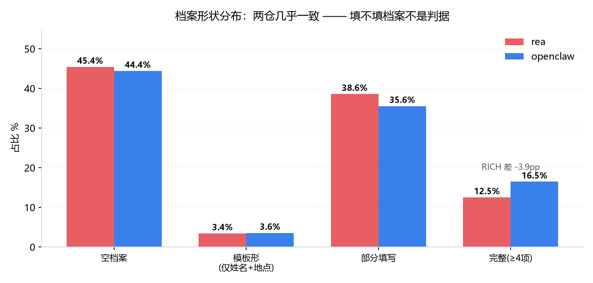

| 形状 | rea | openclaw | 差异 |
|---|---:|---:|---:|
| 空档案 | 45.4% | 44.4% | +1.0pp |
| 模板形（仅姓名+地点） | 3.4% | 3.6% | −0.2pp |
| 部分填写 | 38.6% | 35.6% | +3.0pp |
| **完整（≥4 项）** | **12.5%** | **16.5%** | **−4.0pp** |

**填不填档案不是判据**——两仓都有近一半人完全不填。

---

## 图 9｜两轴四象限（禁止把两轴加成一个分数）

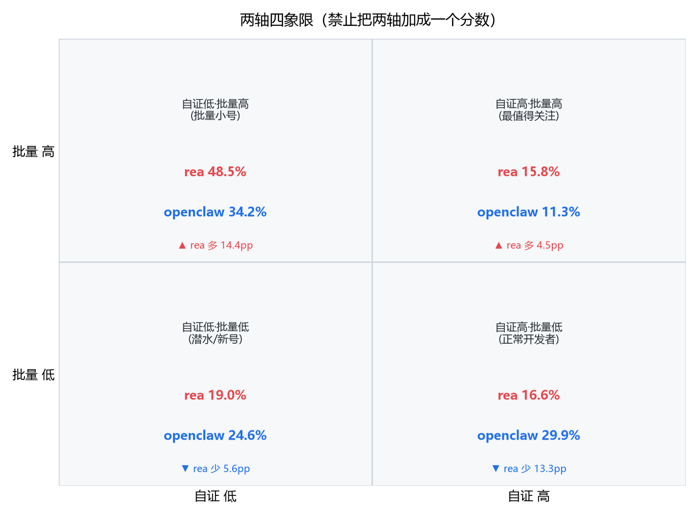

| 象限 | rea | openclaw | 差异 |
|---|---:|---:|---:|
| **自证低 · 批量高**（批量小号） | **48.5%** | 34.2% | **+14.4pp** |
| **自证高 · 批量低**（正常开发者） | **16.6%** | **29.9%** | **−13.3pp** |
| 自证高 · 批量高（最值得关注） | 15.8% | 11.3% | +4.5pp |
| 自证低 · 批量低（潜水/新号） | 19.0% | 24.6% | −5.6pp |

**rea 少了一半的"正常开发者"（16.6% vs 29.9%），多了一批"批量小号"（48.5% vs 34.2%）。**

> ⚠️ 两轴**必须分开看**：单看任一轴都会出错。曾有 11 人同时落在"自证高 × 批量高"——
> 有真实足迹、但动作高度同步。这正是单维判定必然漏掉的象限。

---

## 图 10｜活跃天数 × 开发事件占比

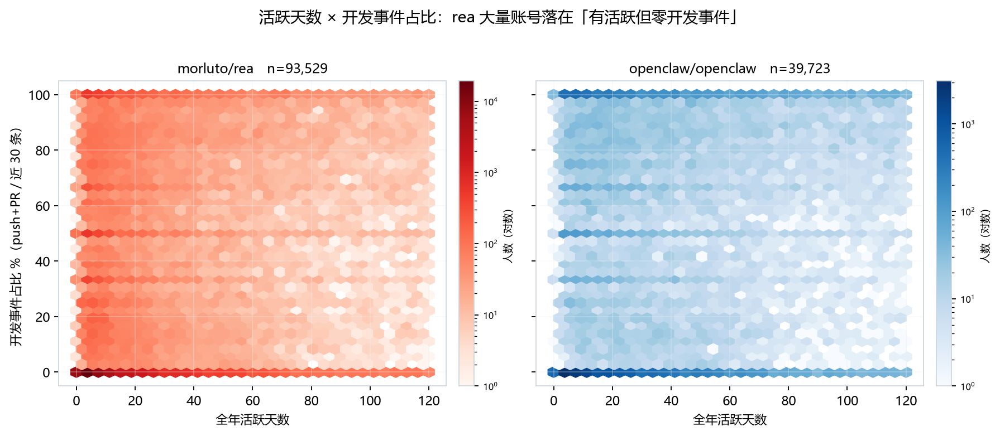

| 指标 | rea | openclaw |
|---|---:|---:|
| 开发事件占比（中位） | **0.00** | **0.27** |

rea 有大量账号落在「**有活跃、但零开发事件**」的区域——他们的近 30 条事件里
一条 Push/PR 都没有，只有 Watch/Fork。

> ⚠️ 此图有**时间混淆**：rea 的 fork 在 10 月（还在 RSS 的 30 条窗口内），
> openclaw 的 fork 在 1–3 月（早已滚出窗口）。所以只能作参考，不能单独定论。

---

## 图 11｜对照组：3 个已知A 组仓库 vs 5 个B 组仓库（2026-11-15 新增）

为检验判据是否真有检出力，加入 3 个被 StarScout 研究列为疑似案例的A 组仓库，与 2 个B 组（无相关报道）。

### 八仓实测

| 判据 | shardeum假 | union假 | anoma假 | rea | openclaw | BettaFish | ollama净 | langchain净 |
|---|---:|---:|---:|---:|---:|---:|---:|---:|
| **有自建仓** | 64.1% | 58.1% | 54.4% | 73.1% | 75.2% | 75.1% | 75.8% | **80.3%** |
| **零提交** | 53.4% | 53.7% | 61.6% | 17.0% | 18.1% | 41.0% | **49.5%** | 45.0% |
| fork 后动过 | 8.5% | 6.6% | **73.5%** | 8.4% | 33.5% | 10.9% | 25.6% | 34.6% |
| 零粉丝 | 35.2% | 41.8% | 66.5% | 41.6% | 28.1% | 27.8% | 22.5% | 23.2% |

| 中位数 | A 组三个仓 | B 组五个仓 |
|---|---|---|
| **提交数** | **0 / 0 / 0** | 6 / 6 / 2 / **1 / 1** |
| 自建仓数 | 1 / 1 / 1 | 2 / 3 / 2 / 3 / 6 |

### 分组判定

| 判据 | A 组 | B 组 | 间距 | 判定 |
|---|---|---|---:|---|
| **`has_own`** | 54.4–64.1% | **73.1–80.3%** | **9.0pp** | ✅ **零重叠** |
| `commit_zero` | 53.4–61.6% | 17.0–**49.5%** | 3.9pp | ⚠️ 勉强 |
| `commit_total` 中位 | 0/0/0 | 6/6/2/1/1 | 0 vs 1 | ⚠️ 边界 |
| **`fork_touched`** | 6.6–**73.5%** | 8.4–34.6% | 重叠 | ❌ **彻底失效** |

### 三次结论修正

| 轮次 | 数据 | 当时结论 | 被谁推翻 |
|:--:|---|---|---|
| 1 | rea/openclaw | `fork_touched` 最强（−31pp） | 加入 BettaFish |
| 2 | +shardeum/union | `commit_total` 0 vs 6 最强 | **ollama（中位 1、零提交 49.5%）** |
| **3（定稿）** | +anoma/ollama/langchain | **只有 `has_own` 零重叠** | — |

> **每加一个B 组（无相关报道），判据就弱一分。**
> 如果只做 rea vs openclaw，我们会得出"有 12 条强判据"的错误结论。

### anoma 暴露的"高成本操作"画像

| 特征 | 值 |
|---|---:|
| 账号年龄 | **4,038 天（11 年）** |
| fork 后动过 | **73.5%**（全场最高） |
| 零粉丝 | 66.5% |
| **提交数中位** | **0** ← 唯独这里露馅 |

**"养了 11 年、会 push、会 commit 到 fork、但不写自己的代码"** ——
正好对上"高端服务 $0.80–0.90/颗，用多年老号"。

---

## 方法学：四个必须记录的错误

| 错误 | 当时结论 | 真相 | 教训 |
|---|---|---|---|
| 单页抽样 | rea 时间戳登录名 36% | 全量 **0.56%** | 单页可放大 64 倍 |
| 全局速率基准 | 同秒碰撞 8.14× | 局部校正后 **1.02×** | 基准必须用局部速率 |
| 部分样本对照 | openclaw 同小时 73.3%，判"无差异" | 完整样本 **62.3%**，实际差 19.3pp | 135 人的样本会骗人 |
| 泊松尾部截断 | 注册批次 rea 10.8× vs oc 1.8× | 两仓都是 **0.9×** | λ=17 时众数在 k=17，截断到 k=11 缩小 12 倍 |

**而且时间混淆会让"最强判据"变成假象**：

| 特征 | 表面差异 | 按 fork 龄分桶后 |
|---|---:|---|
| **fork 后动过率** | −25.1pp | **−31 ~ −33pp（更强）** |
| 自建仓 fork 后更新过 | −33.1pp | **−17 ~ −24pp（被高估 1.5 倍，但真实）** |

### 图 11｜时间控制实验（本报告方法学的核心一课）

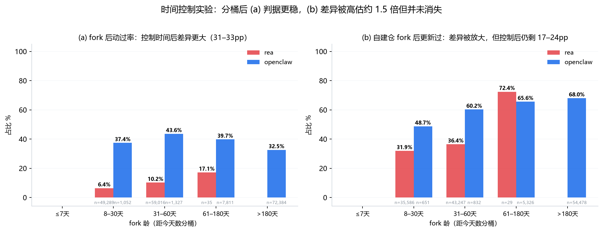

**左图 (a)**：`fork 后动过率` 在 8–30 天、31–60 天两个桶里差 31–33pp——控制时间后差异**更大**。

**右图 (b)**：`自建仓 fork 后更新过` 的表面差异 33.1pp，桶内只剩 17–24pp——
**被时间放大了一倍半，但没有消失**。

### 图 12｜两仓的 fork 龄分布（为什么必须控制）

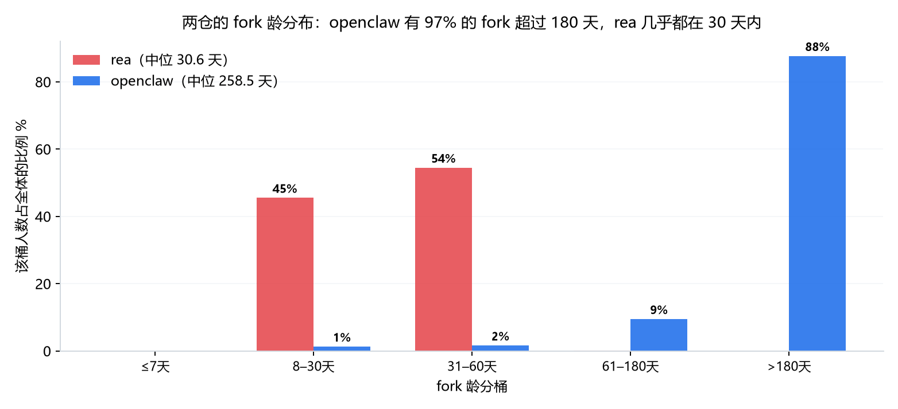

**rea 的 fork 几乎全部在 60 天以内，openclaw 有 88% 超过 180 天。**
直接比较任何"fork 之后"的指标，等于拿 1 个月的观察窗去比 9 个月的。

---

## 结论

### 可以说

> rea 的 fork 使用率在同等时间窗口下显著低于对照仓（**6.4% vs 37.3%**）。
> rea 的 forker 中 **79.0%** 在 5 分钟内完成 star 与 fork（对照仓 59.9%），
> 其中 **50.7%** 是同一秒（对照仓 39.1%）。
> rea 的 fork 高度集中：**6 天覆盖 50%**、14 天覆盖 80%（对照仓 32 天 / 81 天）。
> **但他们的代码能力与对照仓无差异**：有自建仓 73.1% vs 75.2%，
> 自建仓提交数中位都是 4，star 总数中位都是 8。

### 不能说

> ❌ "rea 在异常增长" / "这些 fork 是买的" / "这些账号是机器人"

### 一句话

> **不是"人不行"，是"动作不对"。**
> rea 的 forker 会写代码、有仓库、有提交——但他们的 fork 从不使用，
> 而且 star 与 fork 在同一秒内完成。

---

## 图目录

| 文件 | 类型 | 内容 |
|---|---|---|
| `figs/fork_timeline_rea.png` | 双面板时间轴 + 放大 | rea 逐小时 fork |
| `figs/fork_timeline_openclaw.png` | 双面板时间轴 + 放大 | openclaw 对照 |
| `figs/fork_cumulative_norm.png` | 累积曲线 | 峰值对齐对比 |
| `figs/15_lorenz.png` | 集中度曲线（对数轴） | Top-N 天覆盖占比 |
| `figs/10_effect_ranking.png` | 横向条形 + 分组配色 | 九个判据效应量 |
| `figs/12_star_fork_cdf.png` | CDF（对数轴） | star→fork 延迟 |
| `figs/11_fork_heatmap.png` | 热力图 | 周内 × 小时 |
| `figs/13_feature_matrix.png` | 小提琴 + 箱线矩阵 | 六个特征分布 |
| `figs/14_shape_stack.png` | 分组柱状 | 档案形状 |
| `figs/16_quadrant.png` | 四象限图 | 两轴分类 |
| `figs/17_scatter_dev.png` | 六边形密度图 | 活跃 × 开发事件 |
