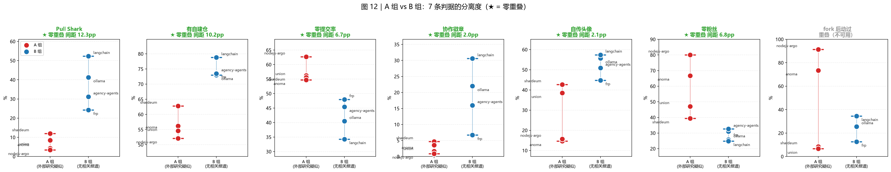
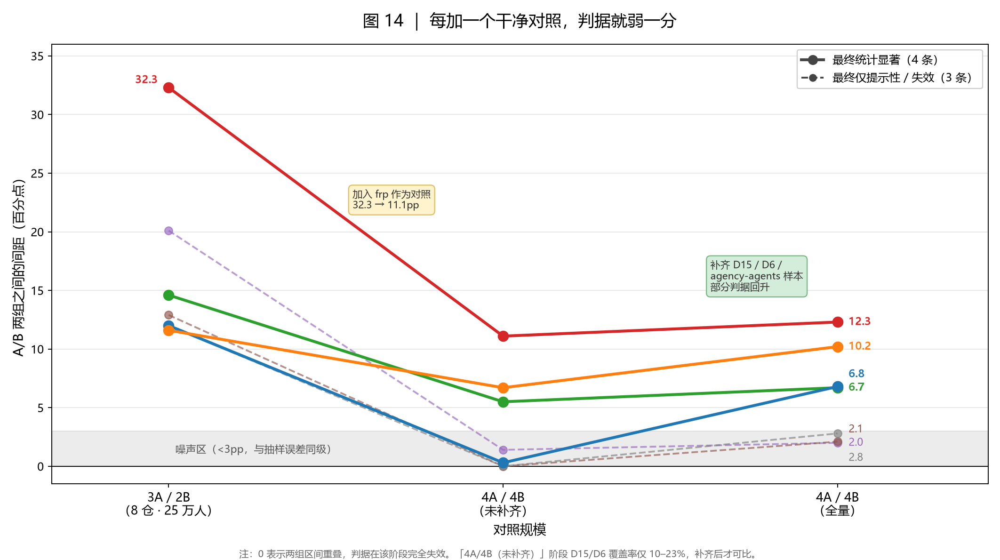
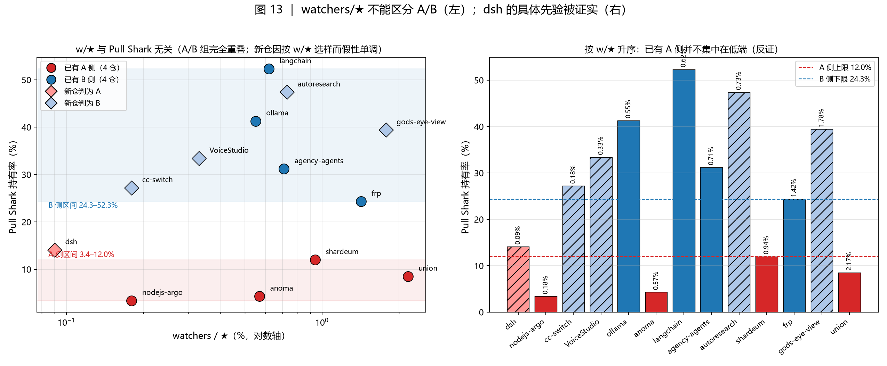

# 一图读懂

> 三张图，四个数字。读完这份，你就知道这个项目做了什么、结论是什么、边界在哪。
>
> 想看完整论证 → [完整分析报告](完整分析报告.md)

---

## 四个数字

|  **29.8 万**  |  **12.3pp**  |  **4 条**  |  **3 条**  |
|:---:|:---:|:---:|:---:|
| 采集的 forker 账号 | 最强判据的间距 | 通过 95% 检验的判据 | 掉进噪声区的判据 |

| 数字 | 什么意思 |
|---|---|
| **29.8 万** | 17 个仓库、36.1 万人名单，实采 29.8 万（82.6%），每人 9 个维度 |
| **12.3pp** | A 侧与 B 侧在 `Pull Shark`（协作徽章）上差 12.3 个百分点，约为抽样误差的 5 倍 |
| **4 条** | 7 条判据里，只有 4 条在 95% 置信水平下显著分得开 |
| **3 条** | 另 3 条点估计零重叠，但置信区间重叠 —— 视为提示性，不算证据 |

---

## 图一：哪些判据能分开两组

**读法**：7 个面板各是一条判据。红点 = A 侧（有外部质疑的 4 个仓），
蓝点 = B 侧（无任何质疑的 4 个仓）。标题带 `★` = 两组区间零重叠。

**结论**：7 条全部零重叠；但真正显著的只有前 4 条。
最右一栏 `fork 后动过` 被标灰 —— 它测的是"fork 拿来用还是拿来收藏"，**与真假无关**。

---

## 图二：判据是怎么一条条失效的 ⭐

**读法**：横轴是对照规模（从 3 个 A + 2 个 B，扩到 4 + 4），
纵轴是两组之间的间距。**纵轴到 0 = 两组区间重叠 = 判据当场失效。**

**结论**：`Pull Shark` 从 32.3pp 一路缩到 11.1pp，最后 12.3pp。
三条判据（协作徽章、自传头像、零关注）直接掉进了 3pp 以下的噪声区。

**这是本项目最重要的发现**：判据不是被"发现"的，是被"剩下的"。

> 最狠的一刀来自 `fatedier/frp` —— 一个真实、干净、十几万星的工具项目，
> 它的 forker 里 Pull Shark 只有 24.3%，远低于 ollama（41.3%）和 langchain（52.3%）。
> **没有这个对照，会以为"低于 13% 就是异常"，实际上正常仓库也能低到 24%。**

---

## 图三：一个被我们自己撤掉的说法

**读法**：左图横轴 `watchers/★`，纵轴 `Pull Shark`。
如果它是个有效信号，两组应该分得开。

**结论**：**分不开。** A 侧均值 0.96%，B 侧 0.82%，完全重叠。

我们曾以为找到了一个"1 次 API 请求就能筛出可疑仓库"的便宜指标。
后来发现那 5 个"验证仓"是**按 `watchers/★` 挑的** ——
先按预测变量选样，再观察它与结果同向，这是循环论证。

**这张图记录的是我们撤回过的一个说法。**

---

## 边界：到这里为止

| 我们能说 | 我们不能说 |
|---|---|
| 两组的 **forker 产出结构不同**，差异可复现、可检验 | 某个仓库**确实**买了星 |
| 差异在 95% 置信下显著 | 哪些账号是刷的 |
| 可以据此**缩小人工核查范围** | 是项目方买的，还是供应商自己刷的 |

**为什么只能做到这里**：这个项目原本想做 **star 造假**，但
`/repos/{o}/{r}/stargazers` 只对仓库所有者开放（匿名 401、非所有者 token 404）。
跨仓的 star 侧研究在数据层面就不可能做，所以退到 fork 侧。
详见[报告 §零 缘起](完整分析报告.md#零缘起我们本来想做的是-star)。

---

**想读完整论证** → [完整分析报告](完整分析报告.md)（10 章，约 1 小时）
**想复现** → [数据结构设计](../data/数据结构设计.md) + [采集方案](../method/采集方案.md)

