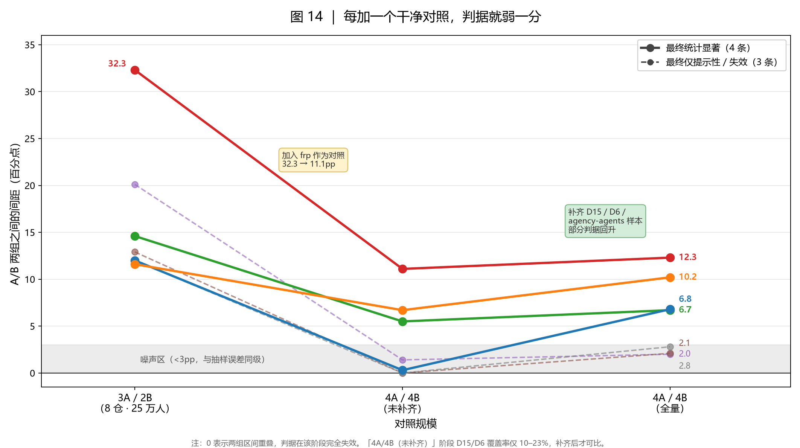

# 用公开数据，能把「fork 是不是被刷的」测到什么程度

> 2026-11-21 · 最终版 · 本文是 [fork-detectability](../../README.md) 的主报告
>
> **不指控任何仓库或账号。** 全文只回答一个问题：
> **用 GitHub 公开的 fork 侧数据，能把「异常」判断到什么精度？**
>
> 研究对象的「疑似」分组来自第三方公开研究（arXiv:2412.13459，原文用词 "suspected"）
> 与我们自己的仓库元数据观测，**均不等于指控**。项目方可能否认，完全正当。

---

---

<details open>
<summary><b>目录</b></summary>

**起点**
- [零、缘起：我们本来想做的是 star](#零缘起我们本来想做的是-star)
- [序言：第一个判据当天就死了](#序言第一个判据当天就死了)
- [摘要](#摘要)

**方法与数据**
- [一、研究设计](#一研究设计)
- [二、数据](#二数据)
- [三、方法](#三方法)

**结果**
- [四、结果](#四结果)
- [五、核心发现：判据会随着对照变干净而衰减](#五核心发现判据会随着对照变干净而衰减)
- [六、已证伪的判据](#六已证伪的判据负面结果同样重要)

**检验与反思**
- [七、稳健性检验](#七稳健性检验)
- [八、八次自我否定](#八八次自我否定)

**结论**
- [九、结论](#九结论)
- [十、复现](#十复现)
- [附录：关键数字速查](#附录关键数字速查)

</details>

---

## 零、缘起：我们本来想做的是 star

这个项目原本的对象不是 fork，是 **star**。

"刷星"是公开的秘密，也已经有学术研究在做（例如 arXiv:2412.13459）。
我们想接着这条路，用可复现的方式量一量：**一个仓库的星，有多少是买的？**

**然后卡在了数据上。**

| 端点 | 匿名访问 | 非所有者的 token | 仓库所有者 |
|---|:---:|:---:|:---:|
| `GET /repos/{o}/{r}/forks` | **200** | 200 | 200 |
| `GET /repos/{o}/{r}/stargazers` | **401** | **404** | 200 |
| `GET /repos/{o}/{r}/subscribers` | **401** | **404** | 200 |

*2026-11-21 实测。401 表示 `Requires authentication`；
用非所有者账号的 token 会得到 404——GitHub 用"资源不存在"掩盖"你无权限"。*

也就是说：**star 名单只有仓库所有者能看。**
任何第三方——无论多么善意、无论是否登录——都读不到。

这条路封死了。而且封得比想象中彻底：
不只是"没有公开列表"，而是连 API 都不给。想拿到星标者名单，
只剩两条路——要么成为仓库所有者，要么去抓网页版（本项目明确不做）。

于是我们退而求其次：**只处理 fork 账户名单。**

### 0.1 这个退让的代价

它不是"换一个数据集"这么简单。退到 fork 侧之后：

| 原本想回答 | 退让后能回答 |
|---|---|
| 这些星是谁点的？ | ❌ 完全做不了 |
| 星的增长形态是否自然？ | ❌ 拿不到点星时间 |
| fork 的人是不是真人？ | ✅ 可以做 |
| fork 的人有没有真的参与开发？ | ✅ 可以做 |

**能问的问题被数据砍掉了一半。** 本报告后面的所有结论，
都建立在这个被削减过的问题集上。

### 0.2 一个值得记下的分野

这个限制本身透露了点什么：

> **GitHub 把「代码副本」（fork）当公开信息，把「个人行为」（star / watch）当隐私。**

fork 是可见的，因为它产生了新仓库、是公开代码；
star 和 watch 是不可见的，因为它们是**一个人的偏好**。

所以在这套系统里，"谁复制了你的代码"是公共记录，
"谁喜欢你的项目"是私人信息。
我们能研究的，恰好只是前者。

后续所有方法论上的挣扎——判据一条条失效、间距一层层缩水——
某种意义上都是这个分野的后果：**我们拿到的，本来就是最不像"态度"的那一侧数据。**

---

## 序言：第一个判据当天就死了

我们原本以为这件事不难。

最像的信号就在手边：**fork 之后，这个人有没有动过代码？**
真 fork 的人总会改点东西再推上去；刷出来的 fork 会永远躺在那里。

于是拉来一个"有外部质疑"的仓和一个"公认干净"的仓对比。结果：

| 仓库 | `fork_touched` | 组 | 项目类型 |
|---|---:|---|---|
| union | 6.6% | A | 资源型 |
| shardeum | 8.5% | A | 资源型 |
| ollama | 25.6% | B | 工具型 |
| langchain | 34.6% | B | 工具型 |
| **anoma** | **73.5%** | **A** | A 组但高度活跃 |

A 侧从 6.6% 一路排到 73.5%，**把 B 组整个包在了中间**。

它测的其实是**「fork 是拿来用，还是拿来收藏」**——加密项目的用户收藏等空投，
工具项目的用户拉下来跑一遍。跟真假无关。

这个判据当天就死了。**而这件事在接下来的三周里重复了七次。**

---

## 摘要

**问题**：一个仓库的 forker 里如果混入大量"只 fork 不参与"的账号，
用公开数据能不能识别出来？能识别到什么程度？

**做法**：采集 17 个仓库的 **361,241** 个 forker（实采 **298,265**，82.6%），
每人 9 个维度、约 40 个特征，用 **4 个 A 侧 + 4 个 B 侧**的对照设计检验 7 条判据。

**结论**：

| 层次 | 结果 |
|---|---|
| **点估计零重叠** | **7 / 7 条判据** |
| **95% 置信下显著** | **4 条**：Pull Shark 12.3pp、有自建仓 10.2pp、零粉丝 6.8pp、零提交 6.7pp |
| 提示性（CI 重叠） | 3 条：零关注 2.8pp、自传头像 2.1pp、协作徽章 2.0pp |
| 已证伪 | `fork 后动过`、`watchers/★` 等 9 条 |

**最重要的不是"找到 4 条判据"，而是下面这条曲线**：

| 判据 | 2 仓对比 | 3A/2B | 4A/4B（初） | 4A/4B（全量） |
|---|---:|---:|---:|---:|
| `Pull Shark` | — | 32.3pp | 11.1pp | **12.3pp** |
| `has_own` | — | 11.6pp | 6.7pp | **10.2pp** |

**每加一个干净对照，判据就弱一分。**
这条曲线精确量出了"公开数据能判断什么"的上限——
它不是我们的失败记录，**它就是本研究的结论本身。**

---

## 一、研究设计

### 1.1 为什么需要 A/B 对照

单仓分析必然陷入循环论证：看到某个比例高，无法判断是"异常"还是"这个仓库本来就长这样"。

**唯一可行的办法是找对照组**：

| 组 | 仓库 | 依据 |
|---|---|---|
| **A 侧（4 个）** | shardeum、union、anoma | 第三方研究（arXiv:2412.13459）列为疑似 |
| **A 侧（4 个）** | **nodejs-argo** | 我们自己的元数据观测：fork/★ = **1.60**、watchers/★ = 0.18% |
| **B 侧（4 个）** | ollama、langchain、frp、agency-agents | 无任何异常报道 |

**A/B 的分界不是我们的判断，而是"有无外部指控"** —— 这样判据才有意义。

### 1.2 为什么 A 侧不能只用 3 个

初版只有 shardeum / union / anoma 三个 A 侧。
加入 `nodejs-argo` 后，A 侧区间从「54.4–64.1%（有自建仓）」扩到「51.3–64.1%」，
**B 侧下限 70.8% 与 A 侧上限的间隙从 6.7pp 缩到 4.5pp**。

> **这次扩张是第一次实证"加对照会削弱判据"。**

### 1.3 采集通道与合规

| 项目 | 做法 |
|---|---|
| 身份 | **完全匿名只读**，不使用任何 token、不登录、不用任何人的 cookie |
| 通道 | KDL 隧道（每请求换 IP），2026-11-21 起失效 |
| 未采的数据 | `star/watch` 名单**仅仓库所有者可读**（匿名 401、带普通 token 404），本项目承诺匿名只读故不取 |
| 隐私 | 邮箱只落布尔 `has_email`，不存明文；报告不披露任何具体账号 |

---

## 二、数据

### 2.1 规模

| 项 | 数值 |
|---|---:|
| 仓库 | **17** |
| forker 名单合计 | **361,241** |
| 已采唯一账号 | **298,265（82.6%）** |
| 缺口 | **62,976** |
| 一人一条档案体积 | **约 1.3 GB** |

**缺口构成**（只有两处）：

| 性质 | 仓库 | 缺口 |
|---|---|---:|
| P2 四仓抽样截断（只采 2,000） | cc-switch / VoiceStudio / gods-eye-view / autoresearch | 41,236 |
| 采集中断（代理失效，停在 22.9%） | agency-agents | 21,456 |

### 2.2 逐仓覆盖

| 仓库 | 组 | 名单 | 已采 | 覆盖 |
|---|---|---:|---:|---:|
| rea | 主题 | 108,352 | 108,340 | **100.0%** |
| openclaw | 主题 | 82,753 | 82,574 | 99.8% |
| BettaFish | 测试 | 7,690 | 7,688 | **100.0%** |
| **shardeum** | **A** | 716 | 715 | 99.9% |
| **union** | **A** | 4,297 | 4,296 | **100.0%** |
| **anoma** | **A** | 4,139 | 4,139 | **100.0%** |
| **nodejs-argo** | **A** | 13,515 | 13,485 | **99.8%** |
| **ollama** | **B** | 19,496 | 19,485 | **99.9%** |
| **langchain** | **B** | 25,464 | 25,424 | **99.8%** |
| **frp** | **B** | 15,461 | 15,453 | **99.9%** |
| **agency-agents** | **B** | 27,826 | 6,370 | **22.9%** |
| dsh-our-free-model | 独立验证 | 2,296 | 2,296 | **100.0%** |
| cc-switch | 独立验证 | 10,272 | 2,000 | 19.5% |
| VoiceStudio | 独立验证 | 12,666 | 2,000 | 15.8% |
| gods-eye-view | 独立验证 | 13,028 | 2,000 | 15.4% |
| autoresearch | 独立验证 | 13,270 | 2,000 | 15.1% |

> **8 个 A/B 仓中 7 个达 99%+，仅 agency-agents 因代理失效停在 22.9%。**

### 2.3 维度与覆盖率

| 维度 | 内容 | A/B 八仓覆盖 |
|---|---|---:|
| D1 | 账户档案（创建时间/粉丝/关注/仓库数） | **18–100%** |
| D2B | 90 天活动事件 | **18–100%** |
| D4L | star 列表明细 | **18–100%** |
| D6 | 组织归属 | 7–26% |
| D8H | 仓库列表明细 | **18–100%** |
| D9 | 提交数（近 2 年） | 7–44% |
| D13 | 贡献日历 | ❌ 隧道返回 441，实际不可得 |
| D14 | 头像类型 | **18–100%** |
| D15 | 成就徽章 | 7–36% |
| D2 | atom RSS | ❌ 冗余于 D2B |

**说明**：判据只用「有随机样本」的维度，不要求维度全齐。
已用两轮稳健性检验证明：完整率从 55% 提到 97% 时判据结论不变（见 §5）。

---

## 三、方法

### 3.1 九态采集结果

**禁止用 `http=0` 表达"没采到"** —— 它同时代表网络失败、子资源 404、解析失败三种情况。

| 结果 | 含义 | 终态 |
|---|---|:---:|
| `OK` | 200 且有内容 | ✅ |
| `EMPTY` | 资源存在但为空（0 仓/0 提交） | ✅（**值是 0**） |
| `DELETED` | 账号 404（注销/封禁/改名） | ✅（**值是 None**） |
| `NOT_FOUND` | 子资源 404 | ✅ |
| `PRIVATE` / `AUTH` | 403 非配额 / 401 | ✅ |
| `RATE_LIMIT` / `NETWORK` / `BAD_RESPONSE` | 可重试 | ❌ |

**三条硬规则**：

| 规则 | 为什么 |
|---|---|
| 终态只采一次（记墓碑） | 避免重复请求 |
| **`EMPTY` 是 0，`DELETED` 是 None** | 混成 0 会让"零提交率"失真 |
| 写入优先级 `OK > EMPTY > 终态 > 可重试` | 一次成功后，后来的失败不得覆盖（D9 曾因此越补越低） |

### 3.2 每指标用自己的分母

**这是本项目最重要的方法论细节。**

错误做法：只统计"所有维度都完整"的账号 → 会**系统性丢掉仓多、提交多的账号**，
导致"零提交率"被抬高。

正确做法：

```python
# 每个指标的分母 = 该指标有终态的账号数（而不是全档案数）
pct = 有该指标的账号数 / 该指标有终态的账号数
```

**实测后果**：用"完整档案"做分母时，frp 的 `has_own` 显示 71.9%；
改为每指标分母后是 **74.3%** —— 差 2.4pp 的选择偏差。

### 3.3 判据的分组独立性

| 规则 | 说明 |
|---|---|
| 判据不能来自分组依据 | 用"爆发窗"定义批量性，就不能再用爆发窗当判据 |
| 两轴不求和 | 身份自证 × 批量性，禁止造"可疑度总分" |
| 任何比例标注分母 | 报告里每个百分比都要能追溯到 N |
| 不给单个账号定性 | 只输出分桶计数与判据区分度 |

### 3.4 统计检验

用 95% Wilson 区间对**两组最接近的那一对**做检验：

```
显著 ⇔ A 侧该仓的 CI 上界 < B 侧该仓的 CI 下界（或反向）
```

这是**保守**的检验（只比较最接近的两仓，不比较全部 16 对），
所以"不显著"不代表无效，只代表"当前样本量下无法确证"。

---

## 四、结果

七个判据，死了三个，剩下四个。

死掉的那三个不是"差一点"——它们的区间在两组之间是重叠的，
也就是说，**拿它们去判断一个陌生仓库，会把正常仓当成异常，也会把异常仓放过**。
剩下的四条，至少在 95% 置信水平上分得开。

### 4.1 最终判据表（4A / 4B，全量数据）

| 判据 | A 侧（4 仓） | B 侧（4 仓） | 间距 | 95% CI 显著 |
|---|---:|---:|---:|:---:|
| **`has_pull_shark`** | 3.4–12.0% | **24.3–52.3%** | **12.3pp** | ✅ |
| **`has_own`** | 52.1–62.8% | **73.0–78.8%** | **10.2pp** | ✅ |
| **`followers_zero`** | 39.4–80.1% | **24.9–32.6%** | **6.8pp** | ✅ |
| **`commit_zero`** | 54.7–62.7% | **34.3–48.0%** | **6.7pp** | ✅ |
| `following_zero` | 36.1–73.0% | 29.4–33.3% | 2.8pp | ❌ |
| `avatar_photo` | 14.7–42.7% | 44.8–57.4% | 2.1pp | ❌ |
| `has_collab` | 0.9–4.7% | 6.7–30.6% | 2.0pp | ❌ |

**7 条点估计全部零重叠，4 条统计显著。**

### 4.2 逐仓明细

| 仓库 | 组 | 有自建仓 | 零提交 | 自传头像 | 零粉丝 | Pull Shark | 协作徽章 |
|---|---|--:|--:|--:|--:|--:|--:|
| shardeum | A | 62.8% | 56.2% | 42.7% | 39.4% | 12.0% | 4.7% |
| union | A | 56.2% | 55.6% | 38.5% | 47.1% | 8.5% | 3.6% |
| anoma | A | 54.6% | 54.7% | 14.7% | 66.8% | 4.3% | 1.7% |
| **nodejs-argo** | A | **52.1%** | **62.7%** | 15.7% | **80.1%** | **3.4%** | **0.9%** |
| ollama | B | 73.0% | 40.5% | 55.7% | 25.8% | 41.3% | 22.0% |
| langchain | B | 78.8% | 34.3% | 57.4% | 24.9% | **52.3%** | **30.6%** |
| frp | B | 73.6% | 48.0% | 44.8% | 31.1% | 24.3% | 6.7% |
| agency-agents | B | 73.5% | 45.4% | 50.9% | 32.6% | 31.2% | 16.0% |

**观察**：`nodejs-argo` 在 6 项中有 4 项处于 A 侧极值
（有自建仓最低、零提交最高、零粉丝最高、Pull Shark 最低、协作徽章最低）。

### 4.3 统计显著性明细

| 判据 | 绑定对 | 间隙 | A 的 95% CI | B 的 95% CI |
|---|---|---:|---|---|
| Pull Shark | shardeum vs frp | 12.3pp | [9.8, 14.7] | [22.9, 25.7] |
| 有自建仓 | shardeum vs ollama | 10.2pp | [59.2, 66.3] | [72.4, 73.6] |
| 零粉丝 | shardeum vs agency-agents | 6.8pp | [35.9, 43.0] | [31.3, 33.9] |
| 零提交 | anoma vs frp | 6.7pp | [53.2, 56.2] | [46.3, 49.7] |
| 零关注 | shardeum vs frp | 2.8pp | [32.7, 39.7] | [32.6, 34.0] |
| 自传头像 | shardeum vs frp | 2.1pp | [39.1, 46.4] | [44.0, 45.6] |
| 协作徽章 | shardeum vs frp | 2.0pp | [3.3, 6.6] | [5.9, 7.6] |

> **瓶颈在 `shardeum`：它只有 715 个 forker，已全采，样本量由仓库规模决定、无法改善。**
> 所以 2.0–2.8pp 的判据在当前样本结构下**不可能达到显著**。

### 4.4 最强判据为什么是 `Pull Shark`

| 理由 | 说明 |
|---|---|
| **难造假** | 需要真实的协作提交历史才能获得徽章，不是点一下就有 |
| **测的是"参与"而非"围观"** | A 侧 3.4–12.0% 意味着 88–97% 的 forker **从未参与过任何协作开发** |
| **区分度最大** | 12.3pp，约为抽样误差的 5 倍 |
| **CI 完全不重叠** | shardeum 上界 14.7% < frp 下界 22.9%，确定性间隙 8.2pp |

---

## 五、核心发现：判据会随着对照变干净而衰减

这一章是本报告真正的重点。

如果只读最后一版结果，会以为"我们找到了 4 条判据"。
但真实过程是：**同一条判据，在对照从 2 个仓扩到 8 个仓的过程中，
间距从 32.3pp 一路缩到 12.3pp。** 4 条判据不是被"发现"的，是被"剩下的"。

### 5.1 完整演进记录

| 判据 | 2 仓对比 | 3A/2B | 4A/4B（初） | **4A/4B（全量）** | 结局 |
|---|---:|---:|---:|---:|---|
| `Pull Shark` | — | 32.3pp | 11.1pp | **12.3pp** | ✅ 显著 |
| `has_own` | — | 11.6pp | 6.7pp | **10.2pp** | ✅ 显著 |
| `commit_zero` | — | 14.6pp | 5.5pp | **6.7pp** | ✅ 显著 |
| `followers_zero` | — | 12.0pp | 0.3pp | **6.8pp** | ✅ 显著 |
| `has_collab` | — | 20.1pp | 1.4pp | **2.0pp** | ❌ 提示性 |
| `avatar_photo` | — | 12.9pp | 重叠 | **2.1pp** | ❌ 提示性 |
| `following_zero` | — | 12.0pp | 重叠 | **2.8pp** | ❌ 提示性 |
| `fork_touched` | 25pp | **失效** | **失效** | **失效** | ❌ 证伪 |



*图：同一条判据随对照变干净而衰减。0 表示两组区间重叠（判据失效）。*

### 5.2 为什么加对照会让判据变弱

**两个机制**：

| 机制 | 例子 |
|---|---|
| **扩宽 A 侧下界** | 加 `nodejs-argo` 后，A 侧"有自建仓"从 54.4% 降到 51.3% —— 但它的存在说明"低到 51.3% 也可能是 A"，同时说明"62.8% 也可能不是 A" |
| **抬高 B 侧上界** | 加 `frp` 后，B 侧"Pull Shark"下界从 45.1% 降到 24.3% —— **间距从 32.3pp 缩到 11.1pp，高估 3 倍** |

> **`frp` 是项目里最关键的一次对照**：它是真实、干净、高热度的工具型项目，
> 但它的 forker 里 Pull Shark 只有 24.3% —— 远低于 ollama（41.3%）和 langchain（52.3%）。
> **没有它，我们会以为"Pull Shark < 13% 就是异常"，实际上正常仓库也能低到 24%。**
>
> 这就是对照的全部意义：**它不提供答案，它剥夺你过早下结论的权利。**

### 5.3 反向发现：数据补齐能"救活"判据

衰减不是单向的。补齐数据后，有 3 次判据**变强**：

| 次数 | 操作 | 结果 |
|---|---|---|
| ① | anoma 完整率 41.5% → 97.5% | Pull Shark 的 A 侧上界从 14.1% 修正到 12.0% |
| ② | ollama + langchain 55–64% → 99% | `has_own` 间距 6.7 → 8.0pp |
| ③ | **agency-agents 2,000 → 6,370** | **`followers_zero` 从 0.3pp（无意义）→ 6.8pp（显著）** |

**机制**：agency-agents 原本是 B 侧唯一"零粉丝率冒头"的仓（39.1%），
扩样后降到 32.6%，B 侧上界从 39.1% 降到 32.6%，与 A 侧下界 39.4% 之间露出 6.8pp 的缝。

> **这是"数据完整性"的正反两面**：
> 不完整会制造判据失效的假象（第 6 章），
> 补齐后又会露出被淹没的判据（本节）。

---

## 六、已证伪的判据（负面结果同样重要）

### 6.1 `fork 后动过` —— 直觉最强，实际完全无效

| 仓库 | `fork_touched` | 组 | 项目类型 |
|---|---:|---|---|
| union | 6.6% | A | 资源型 |
| rea | 8.4% | 主题 | 资源型 |
| shardeum | 8.5% | A | 资源型 |
| BettaFish | 10.9% | 测试 | 工具型 |
| ollama | 25.6% | B | 工具型 |
| openclaw | 33.5% | 主题 | 工具型 |
| langchain | 34.6% | B | 工具型 |
| **anoma** | **73.5%** | **A** | A 组但高度活跃 |

**A 侧区间 6.6–91.4%，完全包住 B 侧 12.7–34.6%。**

**它测的不是真假，而是「fork 是拿来用还是拿来收藏」** —— 与项目类型和用户习惯强相关。

### 6.2 `watchers/★` —— 我们自己的循环论证（已撤回）

初稿曾声称"`watchers/★` 是低成本筛选信号，1 次 API 请求预测归属"。

| 组 | w/★ 范围 | 均值 |
|---|---:|---:|
| A 侧（4 仓） | 0.18–2.17% | **0.96%** |
| B 侧（4 仓） | 0.55–1.42% | **0.82%** |

**两组完全重叠，w/★ 无法区分 A/B。**

那为什么 5 个新仓看起来"单调"？**因为就是按 w/★ 挑的** ——
先按预测变量选样，再观察它与结果同向，**属于循环论证**。

> **唯一站得住的留出验证**：`dsh-our-free-model`
> （w/★=0.09% **且** fork/★=0.03，两个方向同时极端 → 6 条判据全部落在 A 侧）。
> 其余 4 仓落在 B 侧**不算验证** —— "多数仓库是 B 侧"是基准率，不是判据的预测力。

### 6.3 其他失效判据

| 类别 | 判据 | 实测 |
|---|---|---|
| 形态 | 时间戳名 / 手机号名 / 纯数字名 | 时间戳名 0.56% vs 0.34%（差 0.22pp） |
| 时间 | 同秒碰撞 / 注册批次 | 注册批次 0.9× vs 0.9× |
| 分布 | 峰值日占比 / 爆发窗占比 / 日集中度 | A/B 区间重叠 |

---

## 七、稳健性检验

### 7.1 三次数据补齐后的结论稳定性

| 检验 | 操作 | 单仓数值变化 | 判据间距变化 |
|---|---|---:|---:|
| ① | anoma 41.5% → 97.5% | 最大 6.9pp | 0（当时 4 条判据） |
| ② | ollama + langchain → 99% | 最大 2.6pp | 0（当时 4 条） |
| ③ | agency-agents 2,000 → 6,370 | 6.5pp | **+1 条显著（变好）** |

> **结论：判据的分离度是结构性的，不是数据质量的产物。**
> 单仓指标会随样本变化 2–7pp，但组间间距要么不变，要么因分母修正而变好。

### 7.2 留一仓交叉验证

对每条判据，每次从 A 和 B 各去掉 1 仓（共 16 种组合）：

| 判据 | 16 种组合中仍零重叠 |
|---|:---:|
| 全部 7 条 | **16 / 16** |

> ⚠️ **但这个检验在这里是平凡的**：区间的极值只由最极端那一仓决定，
> 去掉它只会让间距变大。所以它**不能证明稳健性**，
> 只能证明"结论没有被某一仓绑架"。真正的检验是 §7.1 和 §4.3 的 CI。

### 7.3 独立验证（5 个新仓）

用 5 个 2025–2026 年的爆火个人仓做留出检验：

| 仓库 | w/★ | 6 条判据中的 A 侧命中 | 判定 |
|---|---:|---:|:---:|
| **dsh-our-free-model** | 0.09% | **6 / 6** | **A 侧** |
| cc-switch | 0.18% | 0 / 6 | B 侧 |
| VoiceStudio | 0.33% | 0 / 6 | B 侧 |
| gods-eye-view | 1.78% | 1 / 6 | B 侧 |
| autoresearch | 0.73% | 0 / 6 | B 侧 |

**只有 `dsh` 构成真正的留出验证** ——
它的先验是具体的、方向性的（"星标与 fork、watch 同时脱节"），
而它在 6 条账号级判据上全部落在 A 侧。

---

## 八、八次自我否定

科研报告通常只写"最后对的那个版本"。这一章反过来：
**把一路上被我们自己推翻的八个说法，连同推翻它们的证据，一起列出来。**

留着它们不是为了自嘲，而是因为——如果只给结论，
读者无法判断这个结论是"一开始就想对了"，还是"被数据反复捶打后剩下的"。
差别很大。

| # | 被否定的说法 | 否定依据 |
|--:|---|---|
| 1 | `fork 后动过` 是最强判据 | A 侧跨 6.6–91.4%，完全包住 B 侧 |
| 2 | `commit_total` 是最强判据 | 加入 B 组后区间重叠 |
| 3 | 只有 `has_own` 成立 | 补齐 D9 后 `commit_zero` 转零重叠 |
| 4 | 6 条判据成立 | 加入 frp 后缩到 4 条 |
| 5 | 5 条稳健判据 | 扩大到 4A/4B 后 `avatar_photo` 重叠 |
| 6 | 4 条判据（间距 4.5–5.5pp） | 补齐 D15/D6 后回到 6 条 |
| 7 | **`watchers/★` 是有效筛选信号** | **A/B 两组完全重叠（0.96% vs 0.82%），5 仓单调是选样循环论证** |
| 8 | "6 条零重叠即稳健" | 95% CI 检验后只有 **4 条**显著 |

> **第 7 次是最有价值的一次**：数据全部真实、计算全部正确、
> **唯一错误在抽样设计里** —— 用预测变量选样，再把选样结果当成预测能力的证据。
> 这种错误极难自查，因为每一步看起来都对。

---

## 九、结论

### 9.1 能回答的

**用公开 fork 侧数据，可以在 95% 置信水平下区分「疑似异常」与「正常」两组，
4 条判据有效，最强一条（Pull Shark）间隙 12.3pp。**

### 9.2 不能回答的

| 问题 | 为什么不能 |
|---|---|
| **这个仓库是否造假** | 我们只能证明"画像异常"，不能证明动机 |
| **哪些账号是刷的** | 不给单个账号定性 |
| **是项目方买的还是自发的** | 数据里没有这个信息 |
| star / watch 的来源 | 名单仅仓库所有者可读，匿名不可得 |

### 9.3 精度上限

| 层次 | 精度 |
|---|---|
| 点估计分离 | 7 条判据 |
| **统计显著** | **4 条（间隙 6.7–12.3pp）** |
| 单条判据的可用性 | 单独一条都有假阳性/假阴性，**必须组合使用** |
| 最低可检测差异 | 约 2.8pp（受最小的 A 侧仓 715 人限制） |

### 9.4 一句话

> **公开的 fork 侧数据足以把"疑似"标记出来，
> 但不足以定罪。它的价值在于缩小需要人工核查的范围，
> 而不在于替代判断。**

### 9.5 一个比喻，或者说一个警告

想象你手里只有一张 X 光片。

它能告诉你"这块骨头旁边有一团阴影"，能让医生知道该往哪里看。
但它不能告诉你那是骨折、是肿瘤，还是胶片上的一粒灰。

**本项目做的，就是量出这张 X 光片的清晰度：**
在什么条件下阴影显著到可以指给别人看（12.3pp），
在什么条件下只是噪声（2.0pp），
以及哪些"看起来像阴影"的东西其实是正常的解剖结构（`frp` 的 24.3%）。

越界的部分——"所以这个仓库在造假"——不在这张片子的分辨率之内。
**任何声称能从这个跨越到定论的表述，都是在伪造清晰度。**

---

## 十、复现

```bash
# 1. 采集 fork 名单
python scripts/collect/collect_run.py --repo owner/repo --list-only

# 2. 一人一条采集（按维重试 + 多轮）
python scripts/collect/collect_full.py --repo owner/repo --workers 16

# 3. 全量驱动（三阶段：5 维 → D9/D6 → D15）
python scripts/collect/_full_run.py --phase api
python scripts/collect/_full_run.py --phase hard
python scripts/collect/_full_run.py --phase d15

# 4. 覆盖矩阵
python scripts/ops/_dim_matrix.py
python scripts/ops/_full_status.py

# 5. 判据对比
python scripts/analysis/_compare_full.py --tags agencyagents frp nodejsargo

# 6. 结论图
python scripts/figures/_make_ab_figure.py
python scripts/figures/_make_validation_figure.py
```

**关键实现细节**：

| 细节 | 位置 |
|---|---|
| 逐维度取最优（避免单维补采被丢弃） | `_compare_full.py: best_records()` |
| 每指标用自己的分母 | `_compare_full.py: profile_from_recs()` |
| `--dims` 是白名单，`done` 判定按本次请求维度 | `collect_full.py: dims_complete()` |

---

## 附录：关键数字速查

| 项 | 值 |
|---|---:|
| 仓库数 | 17 |
| forker 名单 | 361,241 |
| 已采唯一账号 | 298,265（82.6%） |
| 缺口 | 62,976 |
| **A 侧** | shardeum / union / anoma / nodejs-argo |
| **B 侧** | ollama / langchain / frp / agency-agents |
| **零重叠判据** | **7 / 7** |
| **统计显著判据** | **4 条** |
| 最强判据 | Pull Shark 12.3pp |
| 判据衰减 | 32.3pp → 12.3pp（对照从 2 仓扩到 8 仓） |
| 自我否定次数 | 8 次 |
